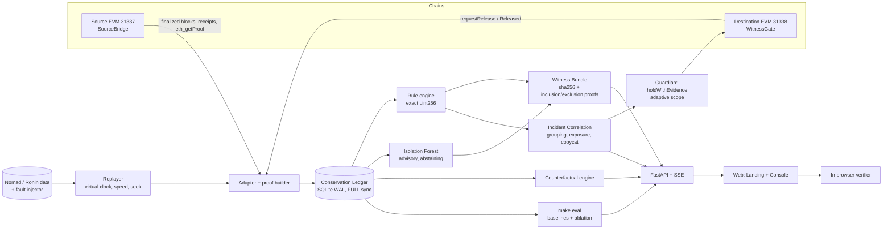

# BridgeWitness — Product Requirements Document

> **Signatures can be stolen. Conservation can't.**
>
> BridgeWitness is an independent monitor and enforcement point for cross-chain bridges. It checks one rule on every release: **tokens released on the destination chain must be backed by a verified, unspent deposit on the source chain.** When the rule breaks, BridgeWitness does three things:
> - It produces evidence that anyone can verify cryptographically.
> - It says honestly when it cannot yet see enough to decide.
> - It holds the release *before* funds move, scoped to the part of the bridge that is actually compromised.

| | |
|---|---|
| Problem statement | Real-Time Detection of Cross-Chain Bridge Exploits |
| Version | PRD v2.2, 9 Oct 2026. v2.2 re-centres the product on the CSB-01 problem statement (§A–§E); v2.1 introduced the "Oxide Vault" UI (§9.0) |
| Codebase | `D:\OM\bridgewitness`: Python engine, FastAPI, Solidity `WitnessGate`, Merkle-Patricia proof verifier, Isolation Forest |
| Research basis | XChainWatcher (arXiv 2410.02029), Count of Monte Crypto (arXiv 2410.01107), XScope (arXiv 2208.07119), Nomad and Ronin datasets |

---

## A. Problem statement CSB-01 and how BridgeWitness answers it

> **CSB-01 · Real-Time Detection of Cross-Chain Bridge Exploits · Chainalysis**
> *Problem:* bridges move billions and are the largest single source of crypto hacks. Exploits (fake deposits, signature forgery, liquidity draining) complete within minutes, faster than manual monitoring can react.
> *Expected solution:* a monitoring dashboard that ingests a live or replayed transaction feed from a public testnet/bridge dataset, flags anomalous patterns (**volume spikes, unusual signer behavior, mismatched deposit/withdrawal pairs**), and raises a **risk-scored alert with the suspected exploit type**. A working demo on a simulated attack replay is sufficient.
> *Reference:* XChainWatcher, arXiv 2410.02029 (also the source of our datasets).

**BridgeWitness is that dashboard first.** Everything in §B–§E is organised around these requirements; the seven capabilities in §6 are what we add *on top* of them.

### A.1 Requirement checklist

| # | CSB-01 requires | What BridgeWitness does | Where to see it | Data | Status |
|---|---|---|---|---|---|
| R1 | Monitoring dashboard | Console home **Monitor**: feed picker, live transaction stream, three signal panels, alert queue | `/console/monitor` | all feeds | ✅ built (frontend, fixture mode) |
| R2 | Ingest a **replayed** feed from a public bridge dataset | Replays the XChainWatcher **Nomad** (1–2 Aug 2022, 575 releases) and **Ronin** (±6 h around 23 Mar 2022, 110 releases) datasets on a virtual clock (1–1000×, seek) | Monitor · Replay | XChainWatcher CSVs (MIT) | ✅ built |
| R2b | Ingest a **live** feed | Two local EVM chains (Ganache 31337 → 31338) with a bridge, a gate and a finalized-block scanner; public-testnet adapter is roadmap | Gauntlet, Evidence | `live_demo_report.json` | ✅ local chains (reference); 🔨 SSE wiring; 📅 public testnet |
| R3 | **Simulated attack replay** | Seeded simulated bridge (5-of-9 validator set, 3 routes). Background amounts and deposit→release delays resampled from real Ronin transfers; eight scheduled attacks/controls | Monitor (default feed) | synthetic, seed 2410 | ✅ built |
| R4 | Flag **mismatched deposit/withdrawal pairs** | **Conservation Ledger**: every release must consume a verified, unspent deposit, to the wei. Rules: missing deposit, replay, over-consumption, amount mismatch, recipient mismatch, fake deposit | Monitor · Evidence | all feeds | ✅ rule (ported, golden-tested) |
| R5 | Flag **volume spikes** | **Velocity detector**: per-route 5-min count, 5-min vs 1-h rate, 5-min volume vs 24-h median; robust deviation with a threshold fixed on pre-attack validation data | Monitor | all feeds | ✅ built (TS port of reference baseline) · advisory |
| R6 | Flag **unusual signer behavior** | **Signer forensics**: unauthorized signer, quorum not met, duplicate signers (rules); lockstep signer sets and valid-quorum-on-unbacked-release (behaviour) | Monitor · Gauntlet | simulated feed, live chains | ✅ built · datasets carry no signer data |
| R7 | **Risk-scored alert** | Risk 0–100 with its breakdown always shown: base(exploit type) + min(15, 3·log10 USD) + campaign × evidence completeness. A ranking, not a probability | every alert | all | ✅ built |
| R8 | **Suspected exploit type** | Fake deposit · Signature forgery · Validator key compromise · Unbacked release · Message replay · Mismatched pair · Liquidity drain (incident level) · Volume / signer anomaly (advisory) | every alert | all | ✅ built |
| R9 | Faster than manual monitoring | Event-time detection at the first offending release; engine p50 0.82 ms per deposit+release pair; a pre-execution gate holds releases before funds move | Monitor, Theatre | benchmark.json | ✅ measured locally |

### A.2 What the three signals each catch (measured, see §D)

| Signal | Catches | Misses | Role |
|---|---|---|---|
| Mismatched pairs (backing rule) | Fake deposits, unbacked releases, replays, over-claims, amount/recipient tampering, regardless of how valid the signatures are | Needs source coverage; with missing data it says `unknown`, never "attack" | **Decides**: can trigger containment |
| Volume spikes (velocity) | Bursts: copycat swarms, rapid draining | Single large thefts (Ronin: 0 of 2 flagged), slow salami; false alarms on busy legitimate periods | **Advises**: raises rank, never contains |
| Signer behaviour | Forged/unknown signers, short quorum, stolen keys acting in lockstep, valid signatures on unbacked releases | Needs signer data (absent from the public datasets) | Rules decide; behaviour advises |

---

## B. Features and USPs in plain words

Each entry: **what it is**, **in plain words**, **how it works**, **data it runs on today**, **status**, **honest limits**.

### B.1 The three problem-statement signals

**1. Mismatched deposit/withdrawal pairs: the Conservation Ledger** *(our core)*
- *Plain words:* a bridge is a vault with two doors. Money may only leave the far door if the same amount came in through the near door, for the same person. We check that, for every single release, to the last wei.
- *How:* each release is matched to the deposit (by route + message id) that authorizes it, in exact 256-bit integer arithmetic. Rules: `missing_source_authorization`, `message_replayed`, `authorization_overconsumed`, `amount_mismatch`, `recipient_mismatch`, `source_value_mismatch` (fake deposit).
- *Data:* all three feeds; the rule is the TypeScript port of the reference `assess_accounting`, golden-tested against all 12 Python bundles.
- *Status:* ✅ built. *Limits:* it needs to have seen the source chain completely; if it hasn't, the verdict is `unknown`. The backing invariant itself is prior art (XChainWatcher, Count of Monte Crypto), cited.

**2. Volume spikes: the velocity detector**
- *Plain words:* a smoke alarm for unusual bursts of withdrawals on one route.
- *How:* per route, three features (releases in the last 5 min, 5-min rate vs 1-h rate, 5-min volume vs the 24-h median amount); robust deviation against a baseline; warning above a threshold that was chosen on pre-attack validation data only (`behavior_model.json`, 10.99). It abstains until a route has 20 transfers of history.
- *Data:* all feeds. *Status:* ✅ built (port of the reference velocity baseline). *Limits:* it is **advisory**. On real data it fires late or not at all on the big thefts (§D) and it false-alarms on busy honest periods. That is exactly why it ranks alerts but never triggers containment.

**3. Unusual signer behaviour: signer forensics**
- *Plain words:* the bridge's guards sign each release. We check that the right guards signed, enough of them, and that they are not acting strangely.
- *How:* rules (`unauthorized_signer`, `signer_quorum_not_met`, `duplicate_signers`) plus two behaviour checks: **lockstep** (the exact same signer set co-signing ≥ 4 releases in 5 min on a route where honest validators rotate) and **valid quorum on an unbacked release** (the Ronin pattern: stolen keys sign perfectly valid signatures for money that was never deposited).
- *Data:* simulated feed (5-of-9 validator set) and the live local chains. The public Nomad/Ronin datasets contain **no signer data**, so this signal is not applied to them.
- *Status:* ✅ built. *Limits:* a careful attacker with stolen keys can avoid lockstep; the backing rule still catches the unbacked release.

### B.2 Risk-scored alert with the suspected exploit type
- *Plain words:* every alert says **what we think is happening, how serious it is, and why**, with the arithmetic shown.
- *Exploit types:* Fake deposit · Signature forgery · Validator key compromise (valid signatures, no deposit) · Unbacked release (no signer data) · Message replay · Mismatched pair · Liquidity drain (incident: unbacked releases + volume spike) · Volume anomaly / Signer anomaly (advisory, no rule broken).
- *Risk score:* `clamp(base(type) + min(15, 3·log10 USD) + campaign(≤5), 0, 100) × evidence completeness`. Base: key compromise / unbacked / replay / forgery 80, fake deposit 75, mismatch 65, signer anomaly 35, volume anomaly 25, overdue 10. It is a **ranking, not a probability**.
- *Status:* ✅ built.

### B.3 The seven capabilities on top (what makes us different)

| # | Capability | In plain words | Status |
|---|---|---|---|
| 1 | Proof of Non-Deposit | Instead of "we didn't see a deposit", a cryptographic proof from the source chain's own state that the deposit slot is empty | 🔨 backend Step 2 (spike verified on Ganache) |
| 2 | Re-executable evidence | Every alert ships as a file your browser re-checks: block header hash, Merkle proofs, the rule, the SHA-256. Change one wei and it fails | ✅ built, 12/12 golden bundles |
| 3 | Watermarked verdicts | "Rule broken" vs "can't see yet" are different answers. RPC lag gives `unknown`, never a false alarm | ✅ built (replay preview) |
| 4 | Pre-execution gate + adaptive scope | Releases wait 30 s; a violation is held before funds move; the hold widens message → route → shared verifier only when evidence demands | ✅ route hold on local chains · 🔨 optimistic window, verifier scope |
| 5 | Counterfactual response | Replays a real exploit under five response policies and shows the loss for each, including where our own narrow policy loses | ✅ built, matches the Step 4 table |
| 6 | Incident correlation | Hundreds of violations from one exploit become one incident with live USD exposure and a copycat signal | ✅ built (preview config) |
| 7 | Adversarial self-evaluation | We attack our own monitor (congestion, RPC gaps, a lying indexer) and compare it with whale-alert and z-score baselines | 🔨 backend Step 4; simulated replay controls ✅ |

---

## C. Data we use now

| Dataset | What it is | Size used | Provenance | Used for |
|---|---|---|---|---|
| Nomad normal (`nomad_normal.csv`) | Matched Moonbeam → Ethereum transfers | 4,482 pairs (11 Jan → 1 Aug 2022); 193 on 1–2 Aug | XChainWatcher @ `4cc1ff1`, MIT, SHA-256 pinned | Replay background, velocity history, deposits for the backing rule |
| Nomad attack (`nomad_attack.csv`) | Labelled exploit releases | 382 releases, 167 txs, 14 message ids, 279 recipients, $159,577,598 dataset USD | same | Nomad replay, incident, flow graph, counterfactual |
| Ronin normal (`ronin_normal.csv`) | Matched Ronin → Ethereum transfers | 22,830 (1 Jan → 29 Mar 2022); 108 within ±6 h of the attack | same | Ronin replay background, velocity history, **amount and delay distributions for the simulated replay** |
| Ronin attack (`ronin_attack.csv`) | Labelled exploit releases | 2 releases, 115 s apart, $565,376,765 dataset USD | same | Ronin replay, counterfactual |
| Simulated attack replay | Seeded synthetic bridge (seed 2410) | 130 releases over 3 h: 101 background, 29 attack/control | generated by `web/src/detect/simulate.ts` | The problem statement's demo: all three signals and all exploit types |
| Live local chains | Two Ganache chains, demo bridge + gate | 3 decisions with full execution proofs | `live_demo_report.json` | Act 2 evidence, held release, healthy settlement |
| Reference engine bundles | Python decisions with evidence | 12 bundles | `demo_report.json`, `live_demo_report.json` | Evidence library, golden test |
| Model + baselines | Isolation Forest card, velocity baseline parameters, engine benchmark | — | `evaluation.json`, `behavior_model.json`, `benchmark.json` | Eval page, velocity threshold |

**Not used / not claimed:** no public-testnet traffic yet; no signer data in the public datasets; no live price oracle (USD is the dataset's historical `value_usd`).

---

## D. Measured results (only numbers the code produced)

All figures are produced by `web/scripts/build-fixtures.mjs`, which fails if any of them drift.

| Finding | Number | Source |
|---|---|---|
| Backing rule on Nomad attack releases | **382 / 382** flagged, from the first release (+0 s) | TS port of the reference rule over the dataset (engine preview) |
| Backing rule on normal Nomad traffic 1–2 Aug | **0 / 193** flagged | same |
| Volume-spike detector on Nomad | 314 / 382 attack releases flagged, **first flag at +2,986 s** | velocity port |
| Lost on Nomad before the first volume flag | 17 releases, **$23,591,072 (14.8 %)** | dataset USD |
| Volume false alarms on all normal Nomad traffic | 141 / 4,482 (3.1 %) | velocity port |
| Backing rule on Ronin | **2 / 2** flagged | engine preview |
| Volume-spike detector on Ronin | **0 / 2** (deviation 6.93 and 4.63, threshold 10.99) | velocity port |
| Per-transaction whale alert (> $1M) on Ronin | 2 / 2, but only **after** execution; post-execution recovery ≤ 4.5 % | counterfactual |
| Volume false alarms on all normal Ronin traffic | 343 / 22,830 (1.5 %) | velocity port |
| Simulated replay: each scheduled attack → expected exploit type | 6 / 6 attack scenarios correct; 2 / 2 controls raise no exploit alert | assertions in the fixture script |
| Simulated replay: advisory volume false alarms | 6 / 101 background releases (advisory only, low rank) | velocity port |
| Counterfactual (Nomad) | pause 5.8 % · hold routes 13.2 % · adaptive 7.0 % at 0 s; 10.4 / 65.8 / 33.8 % at 15 min | matches the PRD §6.4 table |
| Browser verifier = Python | 12 / 12 bundles: same hash, same verdict; header + MPT proofs pass | golden test |
| Engine latency (local) | p50 0.82 ms, p99 2.6 ms per deposit + release pair | `benchmark.json` |
| ML model (advisory) | recall 2.34 % (9/384) at FPR 0.44 %; ROC AUC 0.982 on raw score | `evaluation.json` |

**Caveat that must travel with these numbers:** Nomad/Ronin labels come from XChainWatcher's own matching rules, so the 382/382 shows our implementation is correct, not independent detection power. The simulated replay is synthetic by design.

---

## E. Pitch deck content (strong, true, no inflated claims)

**Slide 1 · Title.** BridgeWitness — real-time detection of cross-chain bridge exploits. *"Signatures can be stolen. Conservation can't."* CSB-01 · Chainalysis.

**Slide 2 · The problem.** Bridges are the largest single source of crypto hacks; Chainalysis estimated ~$2B stolen from bridges in 2022. Exploits finish in minutes: Ronin's two withdrawals were 115 s apart; Nomad's 382 releases came from 279 addresses in 2.5 h.

**Slide 3 · Why today's checks miss it.** Signature checks: Ronin's stolen keys produced *valid* signatures. Volume rules: on the real data, a volume-spike detector flagged **0 of 2** Ronin releases and needed **+2,986 s** on Nomad, by which time **$23.6M (14.8 %)** had left. Whale alerts fire *after* the money moves (≤ 4.5 % recoverable on Ronin).

**Slide 4 · What we built (the CSB-01 dashboard).** Ingests replayed public bridge data (Nomad, Ronin) and a seeded simulated attack replay; three signals (mismatched pairs, volume spikes, signer behaviour); every alert risk-scored with the suspected exploit type and its reasoning.

**Slide 5 · The core idea.** Every release must consume a real, unspent deposit, to the wei. It catches fake deposits, forged or stolen-key releases, replays and tampering by the same arithmetic, whatever the mechanism. It flagged **382 / 382** Nomad releases from the first one and **0 / 193** normal transfers (labels from XChainWatcher; we say so).

**Slide 6 · Signals that advise, rules that decide.** Volume and signer behaviour rank and explain; only a broken rule can hold funds. Example from the simulated replay: an airdrop-style burst of 9 honest transfers trips the volume detector, yet raises only a low-ranked advisory, no exploit alert and no hold; a 14-release drain with stolen keys trips all three signals and is typed "validator key compromise".

**Slide 7 · Live demo.** Monitor → simulated replay: fake deposit, signature forgery, replay, key compromise + drain, mismatched pairs; controls stay quiet. Then the real Nomad replay: one incident, exposure climbing, scope escalating to the shared verifier at +2,986 s.

**Slide 8 · Beyond detection (USPs).** Hold *before* execution (route hold proven on local chains); evidence your browser re-runs (12/12 bundles reproduce Python byte-for-byte); `unknown` instead of false alarms; counterfactual losses per response policy; one incident instead of 382 pages.

**Slide 9 · Proof, not promises.** Every number in the product comes from a script that fails on drift. Table of §D.

**Slide 10 · Architecture.** Chain adapters (finalized) → watermark cursor → conservation ledger → signals (velocity, signer) → classifier + risk score → incidents → witness gate; every decision emits a re-verifiable bundle.

**Slide 11 · Honest limits.** Labels are XChainWatcher's; public datasets have no signer data; demo chains are local and unaudited; finality is an RPC assumption; ML is advisory (recall 2.34 %); proof of non-deposit is backend work in progress.

**Slide 12 · Roadmap.** Public-testnet adapter (Sepolia), state-proof evidence, light-client finality, adapters for production bridges, Witness Bundles as an open standard.

**Words to never use on slides:** "100 % accurate", "AI-powered", "funds saved", "prevents all hacks", "real-time on mainnet". Say "would have held", "estimated", "on the replayed dataset".

---

## 0. Executive summary

**What it is.** BridgeWitness is the CSB-01 monitoring dashboard: it ingests a replayed (public bridge dataset) or simulated bridge feed, flags **mismatched deposit/withdrawal pairs, volume spikes and unusual signer behaviour**, and raises a **risk-scored alert naming the suspected exploit type** (§A). On top of that it holds releases before funds move and ships evidence anyone can re-run (§6).

**The observation.** Bridge exploits differ in mechanism but share one effect:
- Ronin, Harmony and Orbit were drained with **valid signatures** from stolen keys.
- Wormhole and Nomad were drained through **verification bugs**.
- In every case the destination chain released tokens that **the source chain never locked**.

Signature checks can't see this (stolen keys sign validly), and volume rules see it late or not at all: on the real data a volume-spike detector flagged 0 of 2 Ronin releases and first fired on Nomad at +2,986 s (§D). A backing check sees it regardless of mechanism, because unbacked value cannot balance.

**The foundation.** The core is a **Conservation Ledger**: exact integer accounting (one-wei precision) that matches every release to the source deposit that authorizes it. The invariant is established prior art (XChainWatcher, Count of Monte Crypto, Wormhole's Global Accountant). We build on it and cite it.

**What we add on top. Seven capabilities:**

| # | Capability | One-line meaning |
|---|---|---|
| 1 | **Proof of Non-Deposit** | A Merkle proof that the deposit does *not* exist in the source bridge's state, not just "our indexer didn't see it" |
| 2 | **Re-executable Evidence** | Every alert ships as a self-contained bundle that the judge's browser re-verifies, down to a single trusted block header |
| 3 | **Watermarked Verdicts** | The monitor separates "rule violated" from "not observable yet", so RPC lag never produces a false exploit alert |
| 4 | **Pre-execution Gate + Adaptive Scope** | Releases wait in a short challenge window, so violations are held *before* funds move, and the hold widens from message → route → shared verifier as the evidence demands |
| 5 | **Counterfactual Response Analysis** | Replays real exploits under different response policies and reports loss vs. disruption for each |
| 6 | **Incident Correlation** | Hundreds of violations from one exploit collapse into one incident with live exposure and a copycat signal |
| 7 | **Adversarial Self-Evaluation** | We attack our own monitor (congestion, RPC gaps, a lying indexer) and measure it against baselines |

**Three demo feeds, one engine:**
- **Simulated attack replay (the CSB-01 demo).** A seeded bridge with a 5-of-9 validator set; background traffic resampled from real Ronin transfers; scheduled fake deposit, signature forgery, replay, validator-key compromise with a liquidity drain, and mismatched pairs, plus two controls (a whale, an honest burst) that must not raise exploit alerts.
- **Real history.** The Nomad exploit of 1 Aug 2022 and the Ronin exploit of 23 Mar 2022, replayed from the XChainWatcher datasets. Nomad: the first unbacked release lands at 21:32:31 UTC and BridgeWitness raises **one incident** instead of 382 alerts.
- **Live attack.** The judge forges a single release on a two-chain local EVM, signed with a real (compromised) validator key. The gate holds it before execution; a healthy route keeps settling, exact to the wei.

---

## 1. Key terms

The rest of the document uses these terms consistently.

| Term | Meaning |
|---|---|
| **Lock / deposit** | Tokens a user locks (or burns) in the bridge contract on the **source** chain |
| **Release / mint** | Tokens the bridge sends (or mints) to the recipient on the **destination** chain |
| **Backing** | The verified source deposit that justifies a release. A release without one is **unbacked** |
| **Authorization / obligation** | The record created by a deposit: asset, exact amount, recipient, destination, message ID. A release *consumes* it |
| **Finalized** | A block that the chain's consensus will no longer revert |
| **Watermark** `wm[chain]` | The latest point in time up to which our view of a chain is complete and finalized |
| **Merkle-Patricia proof** | A short cryptographic path proving that a value is (inclusion) or is not (exclusion) in a block's state or receipts, checkable against the block header |
| **Witness Bundle** | The evidence file attached to every verdict: inputs, proofs, rule version and a SHA-256 content hash |
| **Challenge window** | A short delay between a release being requested and becoming executable, during which it can be held |
| **Blast radius / containment scope** | How much of the bridge a hold covers: one message, one route, or every route behind a shared verifier |
| **Route** | One asset path between two chains, e.g. USDC Sepolia → Base Sepolia |

---

## 2. Problem

### 2.1 Scale
Bridges are the largest single target in crypto. Chainalysis estimated roughly **$2B stolen from bridges in 2022**, about two-thirds of all crypto stolen that year. Approximate public figures:

| Incident | Year | Approx. loss | Root mechanism | Caught by signature checks? | Caught by volume thresholds? | Backing violated? |
|---|---|---|---|---|---|---|
| Ronin | 2022 | ~$624M | 5 of 9 validator keys stolen | No: signatures were valid | After the fact; unnoticed for **~6 days** | Yes |
| Wormhole | 2022 | ~$325M | Signature-verification bypass; 120k wETH minted | No: verification itself was broken | Possibly | Yes |
| Nomad | 2022 | ~$190M | Faulty initialization made every message "proven"; hundreds of copycats | No | Late | Yes, from the first release |
| Harmony Horizon | 2022 | ~$100M | 2-of-5 multisig keys stolen | No | Partially | Yes |
| Multichain | 2023 | ~$126M | MPC key control | No | Late | Yes |
| Orbit Chain | 2024 | ~$81M | Multisig signer keys stolen | No | Partially | Yes |

> These are public, approximate figures for motivation, not results from our system. "Backing violated?" states which invariant each case breaks. Whether BridgeWitness would have flagged it in practice depends on having an adapter with full coverage of that bridge's source chain.

### 2.2 Existing approaches and where they stop

| Approach | Examples, per public descriptions | Where it stops |
|---|---|---|
| Validator quorum / multisig | Every externally verified bridge | Stolen keys produce valid signatures |
| Rate limits / volume thresholds | Wormhole Governor, CCIP per-lane limits, vendor heuristics | An attacker can split the theft into transfers below the threshold |
| ML anomaly scores | Forta-style bots, commercial monitors | Doesn't say *what* is wrong, and the reasoning can't be reproduced |
| Pre-execution ML threat detection | Hexagate (acquired by Chainalysis, Dec 2024) | Predictive; a different layer from ours. We complement it rather than compete |
| Backing reconciliation (research) | XChainWatcher, Count of Monte Crypto | Offline or alert-only; Monte Crypto notes its live monitor "does not prevent" violating transactions |
| Backing reconciliation (product) | Hypernative ("minting without locking") | Closed; its evidence can't be independently checked |
| Protocol-native conservation | Wormhole Global Accountant, Agglayer pessimistic proofs, Cubist Bascule Drawbridge | Strong, but works only inside its own ecosystem; not an independent witness for other bridges |
| Pre-execution simulation | LayerZero Pre-Crime | LayerZero apps only; the app defines its own invariants |
| Rule-based attack classes | XScope (Unrestricted Deposit Emitting, Inconsistent Event Parsing, Unauthorized Unlocking) | Offline. **We adopt its taxonomy** for our violation names |
| Graph-ML classifiers | BridgeGuard (cross-chain execution graphs) | Needs large labelled incident sets. We cite it as a future direction |
| Emergency pause | Most bridges; CCIP's Risk Management Network curse (described as network-wide) | Freezes every user to stop one attacker, so operators hesitate |
| Forensics / tracing | Chainalysis, TRM | Starts after the funds are gone |

**The gap, stated precisely.** The backing invariant itself is solved. We found no public system that combines:
1. **A cryptographic proof that backing is absent**, checkable by a third party.
2. **Pre-execution enforcement by an independent witness**, outside the bridge's own trust set.
3. **Explicit handling of incomplete observation** (watermarks, an `unknown` verdict).
4. **Containment scope chosen and measured on real incident replays.**

> Competitor descriptions come from public material, not audits of their internals. BridgeWitness is positioned as an engineering combination validated by adversarial testing, not as a new academic result.

> **Positioning rule.** Never pitch "AI detects hacks before they happen" (that is Hexagate's product). Pitch: *"Is every released token backed? Here is a proof you can check yourself."* The gate predicts nothing. It refuses to execute what has no backing.

---

## 3. Product identity

### 3.1 Name, lines, metaphor
- **Name:** BridgeWitness
- **Primary line:** *Signatures can be stolen. Conservation can't.*
- **Secondary line:** *Don't trust our alert. Re-run it.*
- **Core metaphor: the Witness Thread.** Every legitimate transfer is a thread tied to a deposit on the source and a release on the destination. The same visual grammar runs through the landing page, console and evidence view:
  - A forged release is a thread **tied to nothing**.
  - A replay is **two releases on one thread**.
  - A salami attack (many small overclaims) is a thread **stretched past breaking**.
  - An unknown is a **dashed thread fading into fog**.

### 3.2 Principles
1. **Invariants decide; ML advises.** Only a deterministic rule violation can trigger containment.
2. **Every verdict carries its evidence.** No alert exists without a bundle that reproduces it.
3. **Blind spots are named.** Missing data means `unknown`, never "attack" and never "fine".
4. **Smallest sufficient intervention.** Hold a message first, widen only when evidence shows a shared cause, and record every hold on-chain.
5. **No inflated claims.** A priority is a ranking, not a probability. ROC AUC is not "accuracy". No USD figure without a stated price source.

---

## 4. Users

| User | Need | What BridgeWitness provides |
|---|---|---|
| **Bridge operator / guardian** | Stop an exploit without freezing everyone | Scoped holds with on-chain justification and explicit recovery |
| **Incident responder** | Know exactly what is wrong, with proof | Witness Bundle: violated rule, exact excess in wei, receipts, proof of missing deposit |
| **External auditor / exchange** | Decide whether to believe an alert | In-browser re-verification; the only trusted input is one block header, which they can cross-check |
| **Protocol risk team** | Choose a response policy | Counterfactual loss vs. disruption across policies and response times |
| **Judge / reviewer** | Check that it is real, deep and different | Replay a real exploit, attack a live bridge, verify the evidence themselves |

---

## 5. Foundation: the Conservation Ledger

**In one line:** every release must consume a verified, unspent deposit, checked in exact integer arithmetic.

**How it works.** Each source deposit creates an **obligation** (asset, amount, recipient, destination, message ID). Each destination release consumes part or all of it.

```text
common      = max(src_decimals, dst_decimals)
authorized  = (src_amount − floor(src_amount · fee_bps / 10000)) · 10^(common − src_decimals)
released    = dst_amount · 10^(common − dst_decimals)
excess      = max(0, previously_consumed + released − authorized)
```

All arithmetic uses Python integers, valid across the full uint256 range. Cross-decimal normalization never loses a wei.

| Attack pattern | Rule that fires | Status |
|---|---|---|
| Forged release (even with valid signatures) | `missing_source_authorization`, raised **only** when the source watermark has passed | ✅ built, live two-chain demo |
| Replay of a used message | `message_replayed` | ✅ |
| Salami: many small overclaims | `authorization_overconsumed` (cumulative) | ✅ |
| One wei over the authorized amount | `amount_mismatch` | ✅ |
| Recipient changed in transit | `recipient_mismatch` | ✅ |
| Fake source deposit (XScope "Unrestricted Deposit Emitting") | `source_value_mismatch` → `fake_deposit` | ✅ / 🔨 transfer-log check |
| Release before source finality | `early_release` | 🔨 (XChainWatcher found 37 such finality breaks) |
| Duplicate / unauthorized signers, quorum shortfall | signer rules | ✅ (adapter-verified signers) |
| Admin mint that bypasses the message path | **Backing Pulse**: supply vs. cumulative authorized | 🔨 |

**Prior art.** This invariant is established by XChainWatcher and Count of Monte Crypto, and it is enforced natively by Wormhole's Global Accountant and Agglayer. We cite them on the slide. Our contribution is what follows.

---

## 6. Unique capabilities

Each capability follows the same structure: **in one line → the problem → how it works → why it is different → stated limits → status.**

### 6.0 Novelty check

| # | Capability | Feasible on the current code? | Distinct from prior art? |
|---|---|---|---|
| 1 | Proof of Non-Deposit | ✅ Ganache 7.9.2 implements `eth_getProof`; `trie` supports proof verification | ✅ strongest: no public per-alert absence proofs found |
| 2 | Re-executable Evidence | ✅ Python verifier built; TS port needed | ✅ |
| 3 | Watermarked Verdicts | ✅ coverage cursor built | ✅ moderate |
| 4 | Pre-execution Gate + Adaptive Scope | ⚠️ gate needs an optimistic redesign (small Solidity change) | ✅ backed by real Nomad numbers |
| 5 | Counterfactual Response Analysis | ✅ computed on repo data | ✅ |
| 6 | Incident Correlation | ✅ one module over existing decisions | ✅ moderate: XChainWatcher outputs rows, not incidents |
| 7 | Adversarial Self-Evaluation | ✅ fault injector + eval script | ✅ observer-fault testing absent from reviewed papers |

---

### 6.1 Proof of Non-Deposit

**In one line:** when we say "this release has no deposit", we attach a Merkle proof that the source bridge's own storage contains no such deposit.

**The problem.** Calling a release *unbacked* is a claim about something **absent**. Every existing monitor bases that claim on its own indexer ("we scanned the source chain and found nothing"), and a third party can't check that. A lagging or faulty indexer turns into a false accusation.

**How it works.**
- Our `SourceBridge` records each deposit in contract storage: `used[keccak(routeId, messageId)] = true`.
- For a suspicious release, the adapter calls `eth_getProof(sourceBridge, [slot], N)` at the source's latest **finalized** block *N*, where `slot = keccak(abi.encode(key, 0))`.
- The response holds an **account proof** (the bridge contract exists in block *N*'s state) and a **storage proof** showing that the deposit slot is empty.
- Both verify against block *N*'s `stateRoot`, in Python (`trie.HexaryTrie.get_from_proof`) and in the browser (`@ethereumjs/trie`).
- The verdict changes from "our indexer saw no deposit" to **"the source chain's state, at finalized block N, provably contains no deposit for this message."**

**Why it is different.** Reconciliation monitors, research and commercial alike, report absence from their own observations. This makes absence a **cryptographically checkable fact**. It is also the direct fix for the "lying indexer" failure in §6.7.

**Stated limits.**
- It works for bridges that record deposits in **state**. Bridges that only emit events fall back to watermark-based absence, and the bundle states which mode was used (`evidence_mode: state_proof | watermark`).
- An absence proof at block *N* says nothing about later blocks. A deposit that arrives later moves the verdict to `unknown`, never to "cleared".
- The block header is supplied by our server (see §6.2).

**Verified (spike, 9 Oct 2026).** On Ganache 7.9.2, `eth_getProof` against the deployed `SourceBridge` returned account and storage proofs. `trie.HexaryTrie.get_from_proof` verified both against the header's `stateRoot`, and the header hash was itself recomputed by `proofs.header_bytes`. Results: deposited slot = `0x01`; never-deposited slot = empty, so exclusion is proven. The script is in the handoff (§17).

**Required contract change: store a deposit *commitment*, not a boolean.** Today `used[id]` only proves that *some* deposit exists. Store instead:

`deposits[id] = keccak256(abi.encode(token, amount, recipient, destinationChainId))`

and keep `used` semantics via `deposits[id] != 0`. A storage proof then proves the deposit's **contents**, so in proof mode the full accounting (amount, recipient) can be recomputed from state alone. That is what lets Gauntlet #12 (lying observer) resolve to `consistent` with exact amounts, instead of merely "a deposit exists".

**Status:** 🔨 extends `proofs.py` (account + storage proofs), the bundle schema and `SourceBridge`.

---

### 6.2 Re-executable Evidence (Witness Bundles)

**In one line:** every verdict ships with everything needed to recompute it, and the judge's browser does exactly that.

**The problem.** Alert scores from existing monitors are opaque. You can't tell which fact caused the alert or check that the conclusion follows from it.

**How it works.** Each decision emits a **Witness Bundle** containing:
- the rule version, route configuration, release, candidate deposits and prior consumption;
- the watermark / coverage state;
- **inclusion proofs** for each receipt and transaction against its block header (`proofs.py` re-encodes every transaction type from legacy to EIP-7702 and recomputes the header hash);
- the **exclusion proof** from §6.1 where applicable;
- a `bundle_sha256` content hash.

Verification happens in three ways:
- **CLI:** `python -m bridgewitness.verify bundle.json` recomputes the verdict (built).
- **Browser:** a TypeScript port of `verify_bundle` plus MPT verification (`@ethereumjs/trie`, `@ethereumjs/rlp`, `@noble/hashes`) runs client-side. It shows each check passing in sequence and ends with *"Recomputed locally: identical verdict, identical hash."*
- **Tamper mode:** the judge edits any field (one wei is enough), re-verifies, and sees exactly which check fails.

**Optional notarization.** `WitnessRegistry.attest(bundleHash, messageId)` records the bundle hash on-chain *before* the execution attempt. That timestamps the claim that the release was caught before funds moved.

**Why it is different.** Most monitors ask you to trust their output. Here the conclusion is **reproducible from the bundle alone**, and the trust boundary is explicit and small.

**Stated limits.**
- The browser removes trust in our **logic**, not our **data**: block headers come from our server.
- On a public testnet, the browser cross-checks the header hash against an RPC or explorer of the judge's choice. On local Ganache this isn't possible, and the UI says so.
- Consensus finality is an RPC assumption; a light client is on the roadmap.

**Status:** ✅ bundle + Python verifier; 🔨 TS verifier with golden cross-tests, tamper mode, registry.

---

### 6.3 Watermarked Verdicts

**In one line:** the monitor distinguishes "the rule is violated" from "we can't see enough yet", using a per-chain completeness watermark.

**The problem.** When a source RPC lags, a release appears with no visible deposit. Naive monitors raise a false exploit alert, and frequent false alerts train operators to ignore real ones. Ignoring missing data is worse: it reports "all clear" while blind.

**How it works.**
- **Watermark.** Each chain has a contiguous, finalized, hash-linked ingestion cursor `wm[chain]`. This is the stream-processing watermark (as in Flink or Dataflow), applied to proving that a cross-chain event is absent.
- **Decision rule.** A release is called *unbacked* only if `wm[source] ≥ release_time` (or a state proof exists). Otherwise it is `unknown`.
- **Safety vs. liveness:**
  - **Safety** (a release without a deposit) can be judged immediately once the watermark passes, because a legitimate release must be preceded by its deposit. → critical.
  - **Liveness** (a deposit without a release yet) is usually just a delayed message. → `overdue` after `finality + SLA`, low severity, never red.
- **Late arrivals.** A deposit that arrives late promotes `unknown` to `consistent` automatically. A `violation` can only be retracted with an audit entry recording an *observer fault*.
- **Reorgs.** A source reorg invalidates the watermark, rebuilds the affected state, and moves affected verdicts to `orphaned` or `unknown` (built).

| Verdict | Meaning | Visual |
|---|---|---|
| `invariant_violation` | Finalized facts break a rule | Solid vermilion, frayed thread |
| `consistent_under_supplied_evidence` | All checks pass on the available evidence | Quiet verdigris, taut thread |
| `unknown` | Source not observed far enough, value unverified, or ambiguous | Hatched; dashed thread into fog |
| `pending` | Destination not finalized yet | Sodium amber, thread still drawing |
| `overdue` | Deposit older than finality + SLA with no release (liveness) | Thin sodium outline, slow pulse |
| `orphaned` | Invalidated by a reorg | Outline only, struck through |

**Severity and confidence are separate fields.** A large release can be high-severity and low-confidence at the same time.

**Why it is different.** Reviewed systems assume complete data. XChainWatcher, for example, uses a fixed finality constant and has no notion of observer lag.

**Status:** ✅ coverage cursor, reorg rebuild, `unknown`; 🔨 `overdue` timer, audited retraction, DEGRADED banner.

---

### 6.4 Pre-execution Gate with Adaptive Containment Scope

**In one line:** releases wait in a short challenge window, so violations are held before funds move, and the hold widens from message to route to shared verifier when evidence points to a shared root cause.

**The problem, measured on the repo's own data (`data/raw/*_attack.csv`):**
- **Ronin:** two withdrawals 115 s apart, $539.9M then $25.5M. **About 95% of the loss left in the first transaction.** Even an instant *post*-execution detector could have saved at most about 4.5%. For single-shot key theft, only pre-execution enforcement changes the outcome.
- **Nomad:** 382 releases, 9 tokens, 279 recipients, $159.6M in the dataset, over 2.5 hours. Share of loss under each hold policy, by response latency:

| Response latency | Pause whole bridge | Hold attacked routes only | Adaptive (escalate to shared verifier on 2nd route) |
|---|---|---|---|
| 0 s | 5.8% | 13.2% | 7.0% |
| 60 s | 10.1% | 17.7% | 11.5% |
| 15 min | 10.4% | **65.8%** | 33.8% |
| 1 h | 17.3% | **100%** | — |

**Reading the result.** Holding only the attacked routes **fails on Nomad**, because the bug sat in the shared message verifier and attackers simply moved from token to token. A narrow hold is correct only when the cause is local to one route (for example, one route's compromised validator set). **The right scope depends on the root cause, so we escalate it based on evidence and measure the trade-off rather than assume it.**

**How it works.**
- **Optimistic gate.** `requestRelease` (quorum-signed) → `challengeWindow` (30 s in the demo) → `execute` is **permissionless** unless held. Healthy traffic needs no human approval. This replaces the current design, where a guardian must approve every release.
- **Detection on the request**, inside the window, before any funds move.
- **Scope escalation:** message → route → shared verifier. The hold widens when the incident engine (§6.6) sees violations on a second route behind the same verifier contract.
- **Accountable holds.** `holdWithEvidence(scope, bundleHash, reasonCode)` records on-chain *why* (the evidence hash), *who* (the guardian) and *what ends it* (`resolve(scope, resolutionHash)`).
- **No automatic resume.** A falling score never reopens a route; only an attested resolution does.
- **ML never triggers a hold.**

**Already demonstrated** in `live_demo.py`: a compromised-validator release reverts on the held route, and the healthy route settles **exactly 25,000,000 base units**.

> Replay assumptions: attackers behave the same after a hold; detection fires on the first unbacked release (which requires source coverage); USD values are the dataset's. The Nomad data covers the Ethereum side only (~$160M of ~$190M reported).

**Status:** ✅ two-phase gate, route hold; 🔨 optimistic window, `holdWithEvidence` / `resolve` / `holdVerifier`, escalation rule.

---

### 6.5 Counterfactual Response Analysis ("Theatre")

**In one line:** replays a real exploit under several response policies side by side and reports loss, disrupted users and time to containment for each.

**The problem.** "We would have stopped it" is the most common and least supported claim in security demos.

**How it works.** Five policy lanes on a shared timeline:

| Lane | Model |
|---|---|
| No monitor | Full replay loss |
| Alert + human | Detection + operator latency *L* |
| Pause whole bridge | Detection + *L*; all routes frozen until recovery *R* |
| Hold attacked routes | Detection + *L*; each attacked route held after its own first violation |
| Adaptive scope | As above, escalating to the shared verifier on the second route |

- A **latency slider** (0 s to 6 days on a log scale, with a "Ronin actual" marker) recomputes the lanes client-side.
- A **Pareto plot** shows loss against disruption, with each policy as a point.
- **Nomad** shows the scope trade-off; **Ronin** shows that post-execution lanes recover at most about 4.5%.
- Every view carries the label: *"Estimated loss under this replay and response model. Attackers may adapt; no funds were recovered."*

**Why it is different.** It turns response policy into a measurable decision, and it openly shows our own narrow policy losing where it should.

**Status:** numbers already computed from repo data; 🔨 `counterfactual.py` plus a TS mirror for the slider.

---

### 6.6 Incident Correlation

**In one line:** groups the many violations of one exploit into a single incident with live USD exposure, a copycat signal and a transparent priority.

**The problem.** Nomad produced 382 violating releases in about 2.5 hours. Raised individually, that is 382 pages. XChainWatcher outputs result rows; it has no incident model.

**How it works.**
- **Grouping.** Violations against the same destination contract/verifier inside a time window merge into one incident, which keeps the set of violated rules. The rule is deliberately **not** part of the grouping key: Nomad copycats reused real message IDs, so one exploit produces both `missing_source_authorization` and `message_replayed` / mismatch violations.
- **Exposure.** A per-token running total, plus USD from the dataset's `value_usd` (labelled "dataset price").
- **Copycat signal.** ≥ N violations from ≥ M distinct beneficiaries within W minutes escalates the incident to *copycat swarm*. The real Nomad timeline: 7 releases in the first minute, 14 by 15 min, 30 by 60 min, 381 by ~150 min, from 279 addresses.
- **Feeds containment.** An incident spanning a second route behind the same verifier is exactly the escalation trigger in §6.4.
- **Priority, with its breakdown always shown:**
  `priority = clamp(base(type) + min(15, 3·log10(exposure_usd)) + campaign(≤ 5), 0, 100) × evidence_completeness`
  - **base:** unbacked / replay 80 · fake deposit 75 · mismatch 65 · early release 45 · velocity 25 · overdue 10
  - **evidence_completeness:** 1.0 when the watermark has passed and the price is known · 0.6 when the price is unknown · 0.4 when the verdict is `unknown`
  - This is a **ranking, not a probability**.

**Status:** 🔨 `incidents.py` over existing decisions.

---

### 6.7 Adversarial Self-Evaluation

**In one line:** we deliberately break our own monitor's inputs and measure the result against simple baselines, with every number produced by one script.

**The problem.** Detectors are usually evaluated only on the attacks they were built for. Real failures come from the observer itself: lag, gaps, reordering, a faulty indexer.

**How it works.**
- **Fault-injected scenarios** derived from the real Nomad stream, each with ground-truth labels:

| # | Scenario | Correct result |
|---|---|---|
| S0 | Normal day | 0 critical; pending deposits resolve |
| S1 | The real exploit | 1 critical incident at the first unbacked release |
| S2 | Congestion: all messages delayed 3× | 0 critical; pending → overdue only |
| S3 | RPC gap: watermark stalls | `unknown` + DEGRADED banner; 0 false violations |
| S4 | **Lying observer:** events dropped, watermark still advances | False violations. This is the documented limit of watermark-based absence |
| S5 | Replay | `message_replayed` |
| S6 | Fake deposit | `fake_deposit` |
| S7 | Amount mismatch | `amount_mismatch` |

- **S4 paired with §6.1.** The same lying-observer fault on the live chain, with Proof of Non-Deposit enabled, produces **no** false violation, because a state proof can't be faked by dropping events. One side-by-side shows both the weakness and its fix.
- **Baselines:** B1 "whale alert" (per-transaction USD > $1M); B2 velocity z-score (10-minute per-token outflow, reusing the existing statistical baseline); B3 the Isolation Forest (optional).
- **Ablation:**
  1. Rule only
  2. + watermark (vs. naive "no match yet → alert")
  3. + incident grouping
  4. + soft signals

  Each step reports false positives on S2/S3 and alerts per incident.
- **Targets fixed before running:** S1 recall ≥ 0.98 · **0 unexplained** critical on S0/S2/S3 (the 5 known Jan–May unmatched releases are reported separately) · event-time detection latency 0 · ≥ 1,000 events/s. Note: every matched Nomad pair in the dataset has `time_difference ≥ 1,860 s`, above the 1,800 s finality, so `early_release` should not fire on S0.
- **Label circularity, stated openly.** The Nomad labels come from XChainWatcher's own matching rules, so reproducing them proves our implementation is correct, not that detection is independently powerful. Mitigations:
  - a clean-room matcher built from the raw fact files and diffed against `SC_WithdrawalsWithoutMatch.csv`;
  - the injected scenarios;
  - the XScope incident catalog already in `data/independent_incident_catalog.json` (6 incidents, 83 transaction references);
  - the 5 pre-exploit unmatched releases (Jan–May 2022), investigated and reported.
- `make eval` writes `eval/results.json`. **No number appears in the UI or on a slide unless the script produced it.**

**Status:** 🔨 `inject.py`, `evaluate.py`; ✅ statistical baseline and model artifacts.

---

### 6.8 Supporting capabilities

**Behavioral ML (advisory).**
- **Model:** an Isolation Forest (128 trees, fixed seed) on 9 causal features. It abstains on cold start, unseen routes and out-of-support inputs.
- **Scoring:** produces normal-tail ranks, not probabilities.
- **Measured held-out:**
  - ROC AUC 0.982 on raw score;
  - **warning recall 2.34%** (9/384) at a 0.44% false-positive rate;
  - the statistical baseline has higher average precision.
- **Role:** a triage hint and an evaluation baseline. **It never triggers containment.** The volume-spike requirement is met by the B2 velocity signal.

**Signer forensics** (required by the problem statement).
- Recovers signers and checks them against the route's validator set: quorum, duplicates, unauthorized signers.
- Valid signatures on an unbacked release are classified as *"suspected validator compromise or verification failure"*, never as "forgery" without evidence.
- A signer heatmap highlights a key that suddenly signs unbacked messages.

### 6.9 Positioning summary

| Capability | Quorum checks | Rate limits | Commercial monitors | XChainWatcher / Monte Crypto | Global Accountant / Agglayer / Bascule | Pre-Crime | **BridgeWitness** |
|---|:-:|:-:|:-:|:-:|:-:|:-:|:-:|
| Backing invariant | ✗ | ✗ | ✓ (advertised) | ✓ | ✓ native | app-defined | ✓ (prior art, cited) |
| Independent of the bridge's trust set | ✗ | ✗ | ✓ | ✓ | ✗ ecosystem-native | ✗ LayerZero only | **✓** |
| Third-party-checkable proof of missing backing | ✗ | ✗ | ✗ closed | ✗ | inside protocol / ZK, not per alert | ✗ | **✓ storage exclusion proof** |
| Explicit `unknown` from incomplete observation | ✗ | ✗ | ? | ✗ | n/a | ✗ | **✓ watermarks, 6 verdicts** |
| Pre-execution enforcement by an external witness | n/a | ✓ blunt | ✓ (claimed) | ✗ alert-only | ✓ native | ✓ | **✓ optimistic window** |
| Containment scope measured on real incidents | ✗ | ✗ | ✗ | ✗ | ✗ | ✗ | **✓ Nomad / Ronin** |

`?` = not determinable from public material.

---

## 7. Feature specification

Priority: **P0** = required for the demo · **P1** = differentiator · **P2** = stretch. Status: ✅ built · 🔨 to build.

| ID | Feature | Pri | Status | Acceptance criteria |
|---|---|---|---|---|
| F1 | Conservation Ledger engine | P0 | ✅ `accounting.py`, `engine.py` | All demo scenarios produce the expected verdicts; randomized conservation tests pass |
| F2 | Two-chain live EVM bridge (Ganache 31337 ↔ 31338) | P0 | ✅ `live_demo.py`, `WitnessDemo.sol` | Compromised-validator release blocked; healthy route releases the exact amount |
| F3 | Witness Bundle + CLI verifier | P0 | ✅ `verify.py`, `proofs.py` | Recomputed verdict equals the stored verdict; one changed byte → verification fails |
| F4 | Realtime stream to UI | P0 | 🔨 SSE `GET /stream` | Decision visible in the UI ≤ 500 ms after ingest |
| F5 | Attack Gauntlet (judge-launched attacks) | P0 | 🔨 `POST /gauntlet/{scenario}` | Each of the 12 scenarios runs on the local chains and resolves to its verdict within 5 s |
| F6 | Backing Pulse (supply reconciliation) | P1 | 🔨 | An owner `mint()` that bypasses the bridge raises `unbacked_supply_delta` |
| F7 | Verify-in-Browser (TS port + MPT) | P1 | 🔨 `web/src/verify/` | Same verdict and SHA-256 as Python on all golden bundles |
| F8 | Accountable hold: `holdWithEvidence`, `resolve`, `WitnessRegistry` | P1 | 🔨 Solidity | Hold tx carries the bundle hash; resume only via `resolve` |
| F9 | Counterfactual Response Analysis | P1 | 🔨 `counterfactual.py` + TS mirror | 5 lanes × latency slider; matches the Python report |
| F10 | Watermark + reorg panel | P1 | ✅ engine / 🔨 `GET /coverage` | RPC kill switch → `unknown`, never `violation` |
| F11 | Nomad reconciliation replay (Act 1) | **P0** | 🔨 `reconcile_replay.py` over `nomad_normal.csv` + `nomad_attack.csv` | Deterministic order `(ts, chain, tx_index, log_index)`; speed 1–1000×; seek; Etherscan links; first violation at 2022-08-01 21:32:31 UTC |
| F12 | Signer heatmap | P2 | ✅ data in events | Compromised validator row highlights on the unbacked request |
| F13 | Eval page: baselines, ablation, model card | P1 | ✅ `/model/report` / 🔨 `make eval` | Every figure rendered from `eval/results.json` |
| F14 | Testnet notarization (Sepolia / Base Sepolia) | P2 | 🔨 | Bundle hash attested, explorer link shown |
| F15 | Evidence permalink + QR | P2 | 🔨 | `/evidence/<sha256>` opens a read-only bundle |
| F16 | **Proof of Non-Deposit** | **P0** | 🔨 `proofs.py` + bundle field + TS verifier | Unbacked-release bundle contains account + storage proofs that `used[key]` is empty at finalized block N; verified in Python and browser; a tampered node fails |
| F17 | **Optimistic gate** | **P0** | 🔨 Solidity + `live_demo.py` | Healthy release executes permissionlessly after the window; held scope reverts |
| F18 | Adaptive containment scope | P1 | 🔨 engine rule + `holdVerifier` | Nomad replay reproduces the §6.4 table; escalation on the 2nd route behind a shared verifier |
| F19 | **Incident Correlation** | **P0** | 🔨 `incidents.py` | Nomad S1 → exactly 1 incident; exposure equals the sum of dataset `value_usd`; breakdown shown |
| F20 | Watermarks + `overdue` | P0 | ✅ cursor / 🔨 timer + banner | S2 → 0 critical; S3 → `unknown` + DEGRADED banner |
| F21 | **Fault injector + `make eval`** | **P0** | 🔨 `inject.py`, `evaluate.py` | Reproducible from a seed; numbers only from the script |
| F22 | Fake-deposit rule | P1 | ✅ value check / 🔨 transfer-log check | Deposit event without a matching ERC-20 Transfer into the bridge in the same receipt → `fake_deposit` |
| F23 | Early-release rule | P1 | 🔨 `accounting.py` | `release_time − deposit_time < finality` → `early_release` |
| F24 | Clean-room Nomad matcher | P1 | 🔨 | Diff against `SC_WithdrawalsWithoutMatch.csv`, explained line by line |
| F25 | **Monitor dashboard** (CSB-01 home) | **P0** | ✅ frontend | Feed picker (simulated / Nomad / Ronin), live stream, three signal panels, alert queue with risk + exploit type |
| F26 | **Volume-spike detector** (velocity) | **P0** | ✅ `web/src/detect/velocity.ts` | Port of the reference velocity baseline; threshold from `behavior_model.json`; advisory only |
| F27 | **Signer-behaviour detector** | **P0** | ✅ `web/src/detect/classify.ts` | Unauthorized / quorum / duplicate rules + lockstep and valid-quorum-on-unbacked behaviour checks |
| F28 | **Exploit-type classifier + risk score** | **P0** | ✅ `web/src/detect/classify.ts` | Maps signals to CSB-01 exploit types; risk 0–100 with breakdown; only rule violations may contain |
| F29 | **Simulated attack replay** | **P0** | ✅ `web/src/detect/simulate.ts` | Seeded; each scheduled attack yields its exploit type; controls raise no exploit alert (asserted in `build-fixtures.mjs`) |

### 7.1 Gauntlet scenarios

| # | Button label | What happens on chain | Expected verdict |
|---|---|---|---|
| 1 | **Steal with a real key** | Compromised validator signs an unbacked 900-unit release | `violation · missing_source_authorization` + non-deposit proof → held |
| 2 | **Salami slice** | 20 small releases against one 100-unit deposit | First over-limit release → `authorization_overconsumed`, exact excess |
| 3 | **Replay** | Same message released twice | `message_replayed` |
| 4 | **Swap the recipient** | Release to a different address | `recipient_mismatch` |
| 5 | **One wei too many** | Release = authorized + 1 wei | `amount_mismatch`, excess = `1` |
| 6 | **Blind the monitor** | Source RPC paused, then a release | `unknown · source_history_incomplete`; no false alarm |
| 7 | **Rewrite history** | Source reorg removes the deposit | `consistent` → `orphaned` / re-evaluated |
| 8 | **Legit whale** (control) | Large, fully backed transfer | `consistent`; volume alone never triggers |
| 9 | **Fake deposit** | A deliberately vulnerable path on a third configured route (`VulnerableSourceBridge.authorizeUnchecked`, Qubit-style) emits `Authorized` without moving tokens. A lookalike contract at another address would simply be ignored, because routes pin the source contract | `fake_deposit` (no matching ERC-20 Transfer into the bridge in the same receipt) |
| 10 | **Jump the gun** | Release before source finality | `early_release` |
| 11 | **Traffic jam** (control) | Relayer delays all messages | `pending` → `overdue`; never critical |
| 12 | **Lying observer** | Indexer drops the deposit event but advances the watermark | Watermark mode: false violation (shown). Proof mode: storage proof shows the deposit exists, so no false alarm |

---

## 8. System architecture



### 8.1 API surface

| Endpoint | Purpose |
|---|---|
| ✅ `GET /health` | Routes, coverage, capabilities |
| ✅ `POST /events`, `GET /decisions` | Ingest; decisions with bundles |
| ✅ `POST /coverage`, `/finalize`, `/reorg` | Watermark and finality control |
| ✅ `POST /evidence/verify` | Server-side recompute |
| ✅ `GET /model/report`, `/historical/replay` | Model card, historical scores |
| 🔨 `GET /stream` (SSE) | Live decisions, watermarks, holds, incident updates |
| 🔨 `POST /replay {scenario, speed, start_ts}`, `/replay/pause`, `/replay/seek` | Nomad and fault-injected replay control |
| 🔨 `GET /incidents`, `GET /incidents/{id}` | Incidents, exposure, breakdown, evidence export |
| 🔨 `GET /ledger?token=` | Expected vs. observed backing per token |
| 🔨 `POST /gauntlet/{scenario}` | Launch an attack on the local chains (demo mode, localhost only) |
| 🔨 `POST /guardian/hold`, `/guardian/resolve` | Accountable, scoped containment |
| 🔨 `GET /counterfactual?incident=&latency=` | Policy lanes |
| 🔨 `GET /backing` | Backing Pulse per route |
| 🔨 `GET /eval/latest` | `make eval` output |

**Security:**
- The adapter bearer token never reaches the browser; the UI uses a read-only viewer token.
- Gauntlet routes exist only with `BRIDGEWITNESS_DEMO=1` and bind to 127.0.0.1.

### 8.2 Building on the existing codebase

The current code already handles the correctness-critical parts. Extend it; don't rewrite it.

| Module | Keep | Extend |
|---|---|---|
| `accounting.py` (`exact-lock-mint-v1`) | Exact uint256 rules, `verify_bundle` | `early_release`, `fake_deposit`; release as `v2` and keep `v1` bundles verifiable |
| `engine.py` | Idempotent ingest, finalize, reorg rebuild | `overdue` timer, late-arrival promotion, audited retraction, incident hook |
| `schemas.py` | `Coverage` model | Expose as `wm[chain]`; add `evidence_mode: state_proof \| watermark` |
| `proofs.py` | Header, transaction and receipt inclusion proofs | Account + storage **exclusion** proofs via `eth_getProof` |
| `monitor.py` | Finalized, contiguous, hash-linked scanner | Kill-switch and lying-observer modes (Gauntlet #6, #12) |
| `live_demo.py`, `WitnessDemo.sol` | Two Ganache chains, compromised-validator flow | Optimistic gate, `holdWithEvidence`, `resolve`, `holdVerifier`; Gauntlet scenarios 1–12 |
| `data.py`, `replay.py` | Pinned, checksummed Nomad/Ronin data | `reconcile_replay.py`: virtual clock, speed, seek, observer lag |
| `features.py`, `model.py`, `train.py` | Causal features, abstaining forest | B2 velocity baseline; forest as optional B3 |
| `api.py` | Auth, existing routes | SSE, replay, incidents, ledger, gauntlet, guardian, eval |
| `tests/` | Everything | Golden bundles (Python ≡ TS), incident grouping, S0–S7 expectations |
| `dashboard/` | — | Replaced by the new web app (§9) |

### 8.3 Problem-statement coverage

| Requirement | Where it is met |
|---|---|
| Live **or replayed** transaction feed | Real Nomad replay + live two-chain EVM, through one engine |
| Volume spikes | B2 velocity signal (soft, ablated); never an exploit verdict on its own |
| Unusual signer behavior | Signer rules + heatmap |
| Mismatched deposit/withdrawal pairs | Conservation Ledger: unbacked, replay, mismatch, overconsumption, fake deposit, early release |
| Risk-scored alerts | Incident priority with a visible breakdown; severity and confidence separate |
| Suspected exploit types | Typed violations following the XScope taxonomy; mechanism always "suspected" |
| Simulated attack replay | Real Nomad replay **and** 12 judge-launched Gauntlet attacks |

---

## 9. Frontend: experience design

> **v2.1 (9 Oct 2026, decided by the product owner):** the frontend was rebuilt under the **"Oxide Vault"** identity and a multi-page architecture. **§9.0 is now authoritative.** Where §9.1–9.6 and the §10 master prompt conflict with it (palette, typography, the pinned 8-chapter scroll story, the six-tab console), §9.0 wins. The honesty mechanics, verdict semantics, motion restraint, violation moment and 3D Witness Bridge remain in force.

### 9.0 Current design system and information architecture (v2.1)

**Identity: "Oxide Vault".** Hardware security module × trading terminal: graphite and gunmetal, machined plates with a chamfered corner, engraved mono labels, an engraved 56 px micro-grid. Colour stays **semantic**:

| Token | Hex | Meaning |
|---|---|---|
| `--bg` / `--panel` / `--line` | `#08090B` / `#111317` / `#23262C` | Graphite base, gunmetal plates, hairlines |
| `--text` / `--text-2` / `--text-3` | `#E9ECEF` / `#A4ABB6` / `#6B727D` | Primary, secondary, engraved labels |
| `--verified` | `#2FD4B5` patina teal | `consistent`, passing proofs, the brand word "Conservation" |
| `--violation` | `#FF6A3D` molten copper | `invariant_violation`, lost value, unbacked edges |
| `--pending` | `#E3B04B` brass | `pending` / `overdue` only |
| Unknown | 45° hatch texture | Never a colour |
| Orphaned | outline + strike | Never a colour |
| `--eth` / `--moon` / `--local` | `#8C9EFF` / `#C9A7FF` / `#9DB2C8` | **Only** on chain identifiers |

**Type.** Display *Unbounded* (wide, engineered); UI *Instrument Sans*; data *Martian Mono* at 87.5 % width with tabular numerals for every hash, amount and block number.

**Still banned.** Purple/blue/cyan gradient washes, glassmorphism, glow borders, gradient blobs, bento grids of identical cards, generic KPI tiles, icon packs (all glyphs are custom 1.5 px), emoji, "AI-powered" badges, bouncy springs, meaningless particles.

**Information architecture (react-router).**

| Route | Page | What it proves |
|---|---|---|
| `/` | Landing: hero with the live 3D Witness Bridge, real Nomad release ticker, Ronin failure mode, **Conservation Ledger playground** (the real rule, editable), verdict legend, **seven capabilities** each with its own working visual, flow-graph teaser, architecture strip, two acts | Every USP explained without docs |
| `/console/monitor` | **CSB-01 dashboard (console home)**: feed picker (simulated attack replay · Nomad · Ronin), transport, live transaction stream, three signal panels (mismatched pairs, volume spikes, signer behaviour), alert queue with risk score + exploit type + reasons | R1–R9 |
| `/console/replay` | Nomad case study: transport (1–1000×, seek, S0–S7 picker), event-density scrubber, per-chain watermark gauges + DEGRADED, incident card (exposure odometer, copycat, scope, priority breakdown), per-token ledger chart, rule breakdown, verdict stream with Etherscan links, "blind the source RPC" (S3 preview) | F11, F19, F20 |
| `/console/graph` | **Cross-chain flow graph (three.js)**: Moonbeam message commitments ↔ Ethereum beneficiaries by token route, edges grown on the replay clock, VOID node for releases with no deposit, fan-out ranking (id 4922 → 279), inspector, route exposure | Replay/copycat structure at a glance |
| `/console/witness` | 3D Witness Bridge fed by the newest releases, alert takeover (RELEASED / AUTHORIZED / EXCESS), aria-live twin | F4 view |
| `/console/incidents[/:id]` | Incident list; `inc_nomad` (exposure over time, copycat checkpoints, scope timeline, token exposure, priority) and `inc_live` (held before execution) | F18, F19 |
| `/console/evidence[/:sha]` | Library of all reference bundles, collapsible tree with violating fields marked, **in-browser Verify** (sha256, rule, route binding, ordering, header RLP+keccak, receipt + tx MPT proofs, state-proof slot, accounting), trust line, **Tamper + diff** | F3, F7, F15 |
| `/console/gauntlet` | 12 sealed attack envelopes with expected verdicts; #1 shows the real local-chain result; lying-observer split view | F5 (launch needs backend) |
| `/console/theatre` | Counterfactual lanes, log latency slider, Nomad/Ronin, loss-vs-breadth plot, mandatory assumptions | F9 |
| `/console/eval` | Scenarios S0–S7, baselines, ablation (pending), engine latency, model card from `evaluation.json` | F13 |
| `/docs/evidence-spec`, `/docs/architecture` | Witness Bundle spec, verdicts and reasons, canonical hashing, verification procedure, trust boundary; components, API contract, routes | "Read the evidence spec" |

**Data provenance in the UI.** `web/scripts/build-fixtures.mjs` reads the pinned CSVs and artifacts, writes `src/data/fixtures/{history,evidence,model}.json`, and fails if any HANDOFF §5 fact, the Step 4 counterfactual table, or the golden verifier test drifts. On-screen labels: `real · replay` (dataset), `engine preview` (TS port of the rule over the dataset, until `reconcile_replay.py` lands), `pending backend` (never filled with invented numbers). The MIT notice for the XChainWatcher data ships at `/THIRD_PARTY_NOTICES.txt` and in the footer.


### 9.1 Experience architecture

```text
LANDING — 8-chapter scroll story "The Unwitnessed Release" (~90 s)
   ├── CTA "Replay Nomad"      ─────────────┐
   └── CTA "Attack the bridge" ─────────────┤
                                             ▼
CONSOLE  ─ [Replay]   Act 1: real Nomad timeline, speed/seek, incident + exposure   (default)
         ─ [Witness]  live 3D bridge + verdict stream + watermarks
         ─ [Gauntlet] 12 attack cards → launch                                      (Act 2)
         ─ [Evidence] bundle exhibit → Verify / Tamper (1 click from any incident)
         ─ [Theatre]  counterfactual lanes + latency slider (Nomad / Ronin)
         ─ [Eval]     baselines vs. ours, ablation, model card
```

**Judge's path through the product:**
1. Scroll the landing story. Each chapter explains one capability.
2. **Replay Nomad** → 21:32:31 → **one** incident, exposure climbing, copycat escalation.
3. Theatre → drag the latency slider and compare hold-routes vs. adaptive vs. pause-everything.
4. **Attack the bridge** → *Steal with a real key* → the gate holds before execution.
5. Evidence → **Verify in my browser** ✓ (including the non-deposit proof) → tamper one wei ✗.
6. Gauntlet → *Lying observer* → watermark mode raises a false alarm; proof mode doesn't.
7. Eval → ours vs. whale alert vs. z-score, plus the ablation.

### 9.2 Visual identity: "Forensic Instrument"
Not a crypto neon dashboard. The look combines a **court exhibit, a precision instrument and an editorial broadsheet**: calm, monochrome and expensive. One color is reserved for the truth.

**Single-signal color rule.** The interface is monochrome, and **color appears only when it encodes a verdict.** When vermilion appears, something is wrong.

| Token | Hex | Use |
|---|---|---|
| `--ink` | `#0B0B0A` | Console background, dark landing chapters |
| `--carbon` | `#151513` | Raised surfaces |
| `--rule` | `#2A2925` | Hairlines, grids, registration marks |
| `--paper` | `#ECE6DA` | Primary text on ink; light chapter background |
| `--bone` | `#A39E92` | Secondary text, axis labels |
| `--signal` | `#FF4A1C` | **Violation only** ("evidence vermilion") |
| `--sodium` | `#E8A93A` | Pending and overdue only |
| `--verdigris` | `#7FA592` | Consistent only, deliberately quiet |
| Unknown | *pattern* | 45° hatch in `--bone` at 30%. **Unknown is a texture, not a color** |
| Orphaned | *outline* | 1px `--bone` outline with strikethrough |

**Typography**
- **Display:** *Instrument Serif*, with italic for emotional lines (e.g. "*Where did this money come from?*").
- **UI:** *Geist*, tight tracking, weights 400/500 only.
- **Data / evidence:** *Geist Mono* with tabular numerals, used for every hash, amount, wei value and block number.
- Money figures are huge (clamp 96–220px, mono). Body copy is small and precise (14–15px).

**Graphic language**
- Crop marks, registration crosses and exhibit tags (`EXHIBIT C · RELEASE 0x9f3a…e1`).
- Oscilloscope-style hairline grids with tick labels.
- Film grain (2–3% noise shader) over everything; an occasional scanline on the console only.
- Custom 1.5px-stroke glyphs drawn for the domain: lock, thread, gate, fog, seal. No generic icon packs.

**Banned: the generic "AI-generated" look**
- Purple/blue/cyan gradients, neon glow borders, glassmorphism, gradient blobs
- Bento grids of identical cards, generic KPI tiles
- Inter at default tracking, Lucide icons everywhere
- Floating particles without meaning, "✨ AI-powered" badges, emoji
- Rounded-2xl everything, unstyled shadcn defaults, bouncy springs

### 9.3 Motion language
- **Easing:** `cubic-bezier(0.22, 1, 0.36, 1)` for reveals; `cubic-bezier(0.65, 0, 0.35, 1)` for the camera. No bounce, ever. Instruments don't bounce.
- **Scroll:** Lenis smooth scroll (`lerp 0.08`) with GSAP ScrollTrigger scrubbing. The camera follows scroll position, not time, so the judge sets the pace.
- **Text:** line-mask reveals (each line slides up out of a clip); mono numbers roll digit by digit like an odometer.
- **The violation moment**, the only loud motion in the product:
  1. 120 ms RGB-split chromatic aberration
  2. A vermilion flash along the frayed thread
  3. A 2px camera shake
  4. Silence

  Everything else is calm, which is why this moment lands.
- **Reduced motion:** every scene has an art-directed static poster frame, and the scroll story becomes stepped sections.

### 9.4 Core 3D scene: "The Witness Bridge" (react-three-fiber)
One persistent WebGL canvas, reused from the landing hero into the console.

- **Two towers of blocks:** source on the left, destination on the right. Thin instanced slabs (2,000+ at 60 fps) in a matte paper material with soft ambient occlusion, rising into darkness with exponential fog.
- **Witness Threads:** a catenary curve from each deposit slab to its release slab, drawn with a custom shader tube (uniforms `uDash`, `uProgress`, `uFray`, `uColor`). Value particles travel along each thread.
  - **Consistent:** taut, faint verdigris.
  - **Unknown:** dashed, fading into fog.
  - **Pending:** still drawing, sodium. **Overdue:** a thin sodium outline with a slow pulse.
  - **Violation:** the release slab glows vermilion, the thread hangs loose, and its free end unravels into fibres (a noise-displaced vertex shader) attached to nothing.
- **Watermark horizon:** a volumetric fog plane across the source tower at the watermark height. Everything above it is unobserved. When the monitor is blinded, the horizon freezes while the destination tower keeps growing, and the new threads turn dashed.
- **Witness Gate:** a camera-aperture ring of hairline blades on each route lane, closing in 0.6 s with a mechanical stepped ease when a hold is applied. A larger **outer verifier ring** around a group of lanes closes on scope escalation.
- **Post-processing:** grain, vignette, subtle depth of field; chromatic aberration only during the violation moment; bloom **only** on `--signal` emissive materials.
- **Camera:** a GSAP timeline bound to scroll on the landing page; damped orbit controls in the console, auto-flying to any new violation.

### 9.5 Landing page: scroll story "The Unwitnessed Release"

Eight pinned chapters, each mapped to one capability. The landing page must explain **every backend capability without the judge opening any documentation.**

| Ch. | Scroll | Visual | Copy (exact) | Explains |
|---|---|---|---|---|
| 0 Hero | 0–8% | Darkness. A single paper thread draws itself between two faint towers; a value particle crosses | **Signatures can be stolen.** *Conservation can't.* Mono microline: `$2B+ stolen from bridges in 2022 · Chainalysis` | Brand |
| 1 The heist | 8–22% | The Ronin replay. Nine validator glyphs, five tick ✓ VALID. A rate-based volume meter stays under its threshold (measured: 0 of 2 flagged). Value pours from the destination tower | "Five valid signatures. No volume spike." Odometer to **$624,000,000**. "Nobody noticed for six days." | Why signatures and thresholds fail |
| 2 The question | 22–32% | The camera dollies to the drained release and traces its thread back to the source tower… nothing. The thread frays; the violation moment fires | *Where did this money come from?* | The backing invariant |
| 3 The ledger | 32–45% | Hundreds of threads, all tied. The formula types itself in mono; odometer `excess = 0`. Then 20 small releases stretch one thread until it snaps one wei past its limit | "Every release must consume a deposit. To the wei." `excess = 1` in vermilion | Conservation Ledger, salami attacks |
| 4 What we can't see | 45–57% | Six thread specimens pinned like lab exhibits: taut, frayed, fogged, drawing, pulsing, struck. Above them, a fog horizon labelled `wm[source]` | "We tell you what we don't know." Each verdict label in mono with a one-line meaning | Watermarked Verdicts |
| 5 The exhibit | 57–70% | The Witness Bundle **explodes** into an engineering exploded-view drawing: block header → state root → **empty deposit slot** → receipts trie → release → SHA-256, with leader lines and callouts. It reassembles into a sealed exhibit tag | **Don't trust our alert. Re-run it.** "This is a proof that the deposit never existed." Inline working button: `Verify this exhibit in your browser →` | Proof of Non-Deposit, Re-executable Evidence |
| 6 The gate | 70–82% | A release enters a 30-second challenge window, drawn as a countdown ring. Inside it, the attacked lane's aperture closes and the other lanes keep flowing. When a second lane behind the same verifier is hit, the outer ring closes too. The hold transaction prints like a thermal receipt: `evidence: 0x…` | "Held before execution. Exactly as wide as the root cause." | Pre-execution Gate, Adaptive Scope |
| 7 The counterfactual | 82–94% | Nomad, 1 Aug 2022. Five racing lanes: no monitor / alert + human / pause everything / hold routes / adaptive. A real draggable log-scale latency slider; a Ronin toggle shows post-execution lanes capped near 4.5% recovered. A small inset collapses 382 alerts into **1 incident** | "Same exploit. Five responses. Measured." Footnote: "Estimated loss under this replay model." | Counterfactual analysis, Incident Correlation |
| 8 Your turn | 94–100% | The bridge rotates into console framing. Two lanes glow faintly: `NOMAD · 2022-08-01` and `LIVE · 31337 → 31338` | Large serif: *Your turn.* Buttons: **Replay Nomad** · **Attack the bridge** · text link "Read the evidence spec" | Converts into the two-act demo |

### 9.6 Console layout
- **Left rail (64px):** six custom glyph tabs: Replay, Witness, Gauntlet, Evidence, Theatre, Eval.
- **Replay (Act 1, default):**
  - Transport bar: play/pause, 1×–1000×, seek, scenario picker S0–S7.
  - Provenance badge: `REAL · REPLAY` or `SYNTHETIC · INJECTED`.
  - Two watermark gauges (Ethereum `6648936`, Moonbeam `1650811245`) with a **DEGRADED** banner when one stalls.
  - **Incident card:** USD exposure odometer, beneficiary counter, token chips, priority breakdown bar (base + exposure + campaign × completeness), copycat escalation.
  - Per-token **ledger chart**: expected backing vs. observed releases, with the gap opening at 21:32:31. Transaction hashes link to Etherscan.
- **Witness:** the 3D bridge at the center (≈60% width).
  - **Verdict Stream** on the right, a ticker of decisions. Each row shows route, truncated message ID, verdict texture chip, priority, exact amount, and separate severity and confidence bars. Clicking a row flies the camera to that thread.
  - **Watermark strip** along the bottom: per chain, finalized height, ingestion cursor, hatched gaps, reorg markers.
- **Alert takeover** (violations only): a full-width vermilion hairline sweeps across, and an **Exhibit card** slides in with:
  - exploit type and violated rule;
  - **RELEASED / AUTHORIZED / EXCESS** as three huge mono numbers;
  - buttons: **Open evidence**, **Hold** (scope pre-selected, guardian confirm), **Verify**.
- **Gauntlet:** 12 attack cards styled as sealed evidence envelopes, each showing the threat in one line, the expected verdict and a **Launch** button. *Lying observer* opens a split view, watermark mode vs. proof mode.
- **Evidence:** split view.
  - **Left:** the bundle as a monochrome collapsible tree, with violating fields in `--signal`.
  - **Right:** the **Verify** panel animates each check in turn: `header hash ✓ → receipts root ✓ → inclusion proof ✓ → state root ✓ → deposit slot empty ✓ → route binding ✓ → accounting recompute ✓ → sha256 ✓`.
  - **Trust line:** "You trusted: 1 block header (0x…). Cross-check it →".
  - **Tamper** makes any value editable; re-verifying shows the failing step with a byte diff.
- **Theatre:**
  - Five lanes on a shared time axis, with a Nomad / Ronin toggle.
  - Log-scale latency slider (0 s → 6 days, "Ronin actual ≈ 6 days" marker).
  - Pareto inset of loss vs. disruption.
  - Mandatory assumptions footnote.
- **Eval:** printed-report style, rendered only from `eval/results.json`.
  - Ours vs. B1 vs. B2 (precision, recall, false positives on S2/S3, alerts per incident, event-time latency).
  - The ablation as a four-step staircase, plus the circularity disclaimer.
  - The model card: confusion matrix as a large typographic grid, with the serif line "Advisory only — never triggers containment."

### 9.7 Frontend tech stack

| Layer | Choice | Why |
|---|---|---|
| Framework | **React 18 + Vite + TypeScript** | Fast HMR, simple deploy |
| 3D | **three.js + @react-three/fiber + @react-three/drei** | Declarative scene, instancing, `<Line>`, `<Instances>`, `<Environment>` |
| Post FX | **@react-three/postprocessing** (Noise, Vignette, ChromaticAberration, selective Bloom) | Film-grade finish |
| Shaders | Custom GLSL via `shaderMaterial` (thread fray, fog horizon, hatch) | Signature visuals no library offers |
| Scroll | **Lenis** + **GSAP ScrollTrigger** | Standard for award-level scroll sites |
| Camera choreography | GSAP timelines (optionally **Theatre.js** for keyframe authoring) | Precise cinematic paths |
| UI motion | **Motion** (Framer Motion) | Layout transitions, alert takeover |
| Charts | **visx** + d3-scale | Bespoke charts without the default chart look |
| Micro-animation | **Rive** state machines (lock, gate, seal glyphs) | Crisp vector motion |
| Primitives | **Radix UI** (unstyled) | Accessibility without a stock look |
| Text effects | Hand-built line-mask and odometer (or React Bits pieces, restyled) | Avoids a template feel |
| Verification | `@ethereumjs/trie`, `@ethereumjs/rlp`, `@noble/hashes` | In-browser MPT, keccak, SHA-256 |
| Data | `EventSource` (SSE) + TanStack Query; MSW fixtures for offline mode | Live stream, cache, demo resilience |
| Fonts | Instrument Serif (Google Fonts), Geist / Geist Mono (`geist` npm) | Distinct editorial voice |

**Performance:**
- First Contentful Paint < 1.5 s; the 3D canvas loads after the hero text paints.
- DPR clamped to [1, 1.75]; instanced meshes; ≤ 150 draw calls.
- `detect-gpu` fallback to 2D canvas threads.
- 60 fps on a mid-range laptop.

**Accessibility:**
- Verdicts are never color-only; texture and label always carry the meaning.
- `--paper` 2px focus rings; `prefers-reduced-motion` honored.
- An `aria-live` text twin of the 3D stream.

---

## 10. Master UI prompt

> **Superseded in v2.1 by §9.0 for palette, typography and information architecture.** Its 3D scene, motion, honesty and data-contract rules still apply.
>
> Paste verbatim into Claude Code, Cursor or v0. It is self-contained.

```text
ROLE
You are a world-class creative technologist who builds Awwwards Site-of-the-Day experiences
(think Active Theory, Lusion, Resn, Immersive Garden) AND production React apps. You are building
the frontend for BRIDGEWITNESS, an independent monitor and enforcement point for cross-chain bridges.
The UI must be unforgettable at first glance, explain a deep technical product to a judge in about
90 seconds of scrolling, and then let them replay a real exploit or attack a live bridge in one click.

PRODUCT IN ONE PARAGRAPH
Bridge exploits differ in mechanism (stolen validator keys, verification bugs) but share one effect:
tokens are released on the destination chain without a matching deposit on the source chain.
BridgeWitness checks that every release consumes a verified, unspent deposit, to the wei. When the
rule breaks it (1) attaches a Merkle proof that the deposit does not exist in the source bridge's
state ("Proof of Non-Deposit"); (2) ships a Witness Bundle the judge re-verifies IN THEIR BROWSER;
(3) uses per-chain watermarks so missing data becomes "unknown", never a false alarm; (4) holds the
release inside a 30-second challenge window BEFORE funds move, widening scope message → route →
shared verifier as evidence demands; (5) replays real exploits under five response policies to
measure loss vs. disruption; (6) collapses hundreds of violations into one incident with live USD
exposure; (7) attacks its own monitor (congestion, RPC gap, lying indexer) and compares itself to
a whale-alert and a z-score baseline.
Act 1 = the REAL Nomad exploit (1 Aug 2022, 382 unbacked releases, 279 copycat addresses).
Act 2 = the judge attacks a live two-chain local EVM bridge.
Lines: "Signatures can be stolen. Conservation can't." / "Don't trust our alert. Re-run it."

CENTRAL METAPHOR — THE WITNESS THREAD (use everywhere)
Each transfer is a thread from a deposit (source tower, left) to a release (destination tower, right).
consistent = taut thread, faint verdigris. violation = FRAYED thread tied to nothing, vermilion.
unknown = dashed thread fading into fog. pending = thread still drawing, sodium amber.
overdue = thin sodium outline, slow pulse (liveness, never red). orphaned = outline, struck through.
Replay = two releases on one thread. Salami = thread stretched until it snaps.

AESTHETIC — "FORENSIC INSTRUMENT"
Court exhibit × precision oscilloscope × editorial broadsheet. Monochrome, calm, expensive.
SINGLE-SIGNAL COLOR RULE: the interface is monochrome; color appears ONLY to encode a verdict.
Tokens (CSS variables on :root):
  --ink #0B0B0A  --carbon #151513  --rule #2A2925  --paper #ECE6DA  --bone #A39E92
  --signal #FF4A1C (violation only)  --sodium #E8A93A (pending/overdue only)  --verdigris #7FA592 (consistent only)
  Unknown = 45° hatch of --bone @30% (a texture, never a color). Orphaned = 1px outline + strike.
Type: Display "Instrument Serif" (italic for emotional lines). UI "Geist" 400/500, letter-spacing -0.01em.
Data "Geist Mono" with tabular-nums for EVERY hash, amount, wei value, block number.
Huge mono numbers (clamp(96px, 14vw, 220px)) for money; small precise body (14–15px).
Graphic grammar: crop marks, registration crosses, exhibit tags ("EXHIBIT C · RELEASE 0x9f3a…e1"),
hairline grids with tick labels, 2–3% animated film grain, custom 1.5px-stroke glyphs.

ABSOLUTELY BANNED (instant fail)
purple/blue/cyan gradients, neon glows, glassmorphism, gradient blobs, bento grids of identical cards,
default shadcn look, Lucide icon spam, emoji, "✨ AI" badges, rounded-2xl everywhere, bouncy springs,
random floating particles, stock hero illustrations, Inter at default tracking, generic KPI tiles.

STACK
React 18 + Vite + TypeScript. three.js + @react-three/fiber + @react-three/drei +
@react-three/postprocessing. GSAP + ScrollTrigger + Lenis (lerp 0.08). Motion (framer-motion) for UI.
visx for charts. Radix UI primitives (unstyled, fully restyled). Rive for glyph state machines (optional).
@ethereumjs/trie + @ethereumjs/rlp + @noble/hashes for in-browser verification. TanStack Query + EventSource.
One persistent <Canvas> shared by landing and console. Lazy-load 3D after hero text paints.
dpr={[1,1.75]}, instanced meshes, ≤150 draw calls, detect-gpu fallback to 2D canvas threads.

MOTION RULES
Reveal ease cubic-bezier(0.22,1,0.36,1); camera ease cubic-bezier(0.65,0,0.35,1). No bounce. Ever.
Text: per-line mask reveals. Numbers: odometer digit roll in mono. Camera is scroll-scrubbed.
Calm everywhere EXCEPT the violation moment: 120ms RGB-split chromatic aberration + vermilion flash on
the frayed thread + 2px camera shake + silence.
prefers-reduced-motion: static art-directed poster per chapter, stepped sections.

THE 3D SCENE — "THE WITNESS BRIDGE"
- Two towers of instanced block slabs (source left, destination right), matte paper material, soft AO,
  rising into darkness with exponential fog.
- Threads: catenary curves between slabs; custom shader tube with uniforms uDash, uProgress, uFray, uColor.
  Value particles travel along threads. Violation: vertex-noise fray at the free end, emissive --signal,
  the ONLY element receiving selective bloom.
- Watermark horizon: volumetric fog plane across the source tower at wm[source]; above it is unobserved.
  It freezes while the destination keeps growing when the monitor is blinded.
- Witness Gate: per-route camera aperture of hairline blades; HOLD closes it in 0.6s with a stepped
  mechanical ease. An outer verifier ring around a group of lanes closes on scope escalation.
- Post: Noise, Vignette, subtle DOF, ChromaticAberration (violation only), selective Bloom.

LANDING — 8 PINNED CHAPTERS "THE UNWITNESSED RELEASE" (ScrollTrigger scrub)
Ch0 Hero (0–8%): black; one paper thread draws between two faint towers; a value particle crosses.
  H1 serif "Signatures can be stolen." italic line 2 "Conservation can't."
  Mono microline "$2B+ stolen from bridges in 2022 · Chainalysis". Scroll cue = thin vertical thread.
Ch1 The heist (8–22%): nine validator glyphs; five tick ✓ VALID; rate-based volume meter stays under its threshold (0 of 2 flagged);
  destination tower pours value; odometer to $624,000,000.
  Copy "Five valid signatures. No volume spike." then "Nobody noticed for six days." (A per-transaction whale alert would have fired, after the funds moved.)
Ch2 The question (22–32%): camera dollies to the drained release, traces its thread back… nothing.
  Thread frays; VIOLATION MOMENT. Giant italic serif "Where did this money come from?"
Ch3 The ledger (32–45%): hundreds of tied threads; formula types in mono
  "Σ released(message) ≤ authorized(message)"; odometer "excess = 0". Then 20 small releases stretch one
  thread until it snaps: "excess = 1 wei" in vermilion. Copy "Every release must consume a deposit. To the wei."
Ch4 What we can't see (45–57%): six thread specimens pinned like lab exhibits (taut, frayed, fogged,
  drawing, pulsing, struck) under a fog horizon labelled wm[source]. Copy "We tell you what we don't know."
Ch5 The exhibit (57–70%): the Witness Bundle explodes into an engineering exploded-view drawing
  (block header → state root → EMPTY DEPOSIT SLOT → receipts trie → release → sha256) with leader lines,
  then reassembles into a sealed exhibit tag. Copy "Don't trust our alert. Re-run it." and
  "This is a proof that the deposit never existed." Working button "Verify this exhibit in your browser →".
Ch6 The gate (70–82%): a release enters a 30s challenge-window countdown ring; the attacked lane's
  aperture closes; other lanes keep flowing; a second hit behind the same verifier closes the outer ring.
  Hold tx prints like a thermal receipt with "evidence: 0x…".
  Copy "Held before execution. Exactly as wide as the root cause."
Ch7 The counterfactual (82–94%): "NOMAD · 2022-08-01". Five racing lanes (No monitor / Alert + human /
  Pause everything / Hold routes / Adaptive) on a shared axis; real draggable log-scale latency slider;
  Ronin toggle; inset collapsing "382 alerts → 1 incident".
  Copy "Same exploit. Five responses. Measured." Footnote "Estimated loss under this replay model."
Ch8 Your turn (94–100%): bridge rotates into console framing; lanes "NOMAD · 2022-08-01" and
  "LIVE · 31337 → 31338". Huge serif "Your turn." Buttons "Replay Nomad" and "Attack the bridge"
  (paper on ink, square corners, underline-draw hover). Text link "Read the evidence spec".

CONSOLE (route /console)
Left rail 64px: glyph tabs Replay · Witness · Gauntlet · Evidence · Theatre · Eval.
REPLAY (default): transport bar (play/pause, 1×–1000×, seek, scenario picker S0–S7); provenance badge
  REAL·REPLAY / SYNTHETIC·INJECTED; two watermark gauges (Ethereum, Moonbeam) + DEGRADED banner;
  INCIDENT CARD (USD exposure odometer, beneficiary counter, token chips, priority breakdown bar
  base + exposure + campaign × completeness, copycat escalation); per-token ledger chart
  expected vs. observed with the gap opening at 21:32:31 UTC; tx hashes link to Etherscan.
WITNESS: live 3D bridge (60% width), damped orbit, auto-flies to new violations.
  Right: VERDICT STREAM rows — route, truncated mono message id, verdict texture chip, priority,
  exact amount, separate severity and confidence bars. Click → camera flies to that thread.
  Bottom: WATERMARK STRIP per chain — finalized height, ingestion cursor, hatched gaps, reorg markers.
ALERT TAKEOVER (violation only): vermilion hairline sweeps the viewport; Exhibit card slides in with
  exploit type, violated rule, three huge mono numbers RELEASED / AUTHORIZED / EXCESS,
  buttons Open evidence · Hold (scope pre-selected, guardian confirm) · Verify.
GAUNTLET: 12 attack cards styled as sealed evidence envelopes: Steal with a real key · Salami slice ·
  Replay · Swap the recipient · One wei too many · Blind the monitor · Rewrite history ·
  Legit whale (control) · Fake deposit · Jump the gun · Traffic jam (control) · Lying observer
  (split view: watermark mode false alarm vs. proof mode correct). Each: one-line threat, expected
  verdict, LAUNCH → POST /gauntlet/{id}; camera follows the live result from SSE.
EVIDENCE: split view. Left: monochrome collapsible bundle tree, violating fields in --signal.
  Right: VERIFY panel animates header hash ✓ → receipts root ✓ → inclusion proof ✓ → state root ✓ →
  deposit slot empty ✓ → route binding ✓ → accounting recompute ✓ → sha256 ✓, all client-side.
  Trust line "You trusted: 1 block header (0x…). Cross-check it →". TAMPER makes values editable;
  re-verify shows the failing step in vermilion with a byte diff.
THEATRE: 5 visx lanes, Nomad|Ronin toggle, log latency slider (0s → 6 days, marker "Ronin actual ≈ 6 days"),
  Pareto inset loss vs. disruption. Mandatory assumptions footnote.
EVAL: printed-report style rendered ONLY from /eval/latest: ours vs. B1 whale alert vs. B2 z-score
  (precision, recall, FP on S2/S3, alerts per incident, event-time latency), ablation staircase,
  circularity disclaimer, model card (recall 2.34%, FPR 0.44%, ROC AUC 0.982 raw score);
  serif line "Advisory only — never triggers containment."

DATA CONTRACT
GET /health, /decisions, /stream (SSE: decision|watermark|hold|incident), /incidents, /incidents/{id},
/ledger?token=, /counterfactual?incident=&latency=, /model/report, /backing, /eval/latest;
POST /replay, /replay/pause, /replay/seek, /gauntlet/{scenario}, /guardian/hold, /guardian/resolve.
Decision fields: status, violations[], unknown_reasons[], suspected_exploit_type, priority, breakdown,
accounting{released_common_units, authorized_common_units, excess_common_units, released_display},
evidence{bundle_sha256, evidence_mode, bundle}. Amounts are decimal STRINGS — use BigInt, never Number.
Ship an MSW mock layer with recorded fixtures so the site runs fully offline.

QUALITY BAR
60fps on a mid-range laptop. FCP < 1.5s. Every verdict readable without color (texture + label).
Keyboard reachable, visible --paper focus rings, aria-live text twin of the 3D stream.
Copy is short, declarative, never hype. Never write "100% accurate", "AI-powered", or "funds saved".
Deliver: folder structure, all components, shaders, scroll timeline, mock fixtures, and a README.
Before finishing, self-review against the BANNED list and the single-signal color rule.
```

---

## 11. Demo script (two acts)

| Beat | Action | Line |
|---|---|---|
| Open | Landing, Ch0–2 | "Ronin lost ~$624M (public estimate) through five valid signatures; a volume-spike detector stays quiet on it. We ask one question: *where did this money come from?*" |
| | Ch3–7, scrolled at the judge's pace | Each chapter introduces one capability in a single sentence |
| **Act 1** | **Replay Nomad** at 60×. Threads tie; a pending deposit resolves; both watermarks are visible | "This is the real Nomad bridge on 1 August 2022, replayed from the public XChainWatcher dataset." |
| | 21:32:31: the first unbacked release → **one** incident; exposure climbs; copycat escalation | "One incident, not 382 alerts. 279 addresses copied the attacker, and we flagged the very first release." |
| | Open the incident → evidence shows "Moonbeam searched up to watermark T: no deposit" + Etherscan link | "The mechanism is *suspected*. The missing backing is *shown*." |
| | Theatre → drag latency; compare hold-routes vs. adaptive vs. pause-everything | "Holding only the attacked routes loses 66% at 15 minutes, because the bug was in the shared verifier. Escalating scope halves that, under this replay model." |
| **Act 2** | **Attack the bridge** → *Steal with a real key* | "Now you're the attacker: a real validator key, below every threshold." |
| | Thread frays; the gate holds inside the challenge window; the healthy route settles 25 tokens | "Held before execution. Healthy traffic never needed a human." |
| | Evidence → **Verify in my browser** → tamper one wei | "Your browser just checked a Merkle proof that the deposit never existed. Change one wei and it breaks." |
| | Gauntlet → *Lying observer*, side by side | "Here we attack our own monitor. Watermark mode raises a false alarm. Proof mode can't be fooled by dropped events." |
| Proof | Eval tab | "Ours vs. a whale alert vs. a z-score, plus the ablation. Every number came from `make eval`." |
| Close | — | "Signatures can be stolen. Conservation can't." |

**Fallback:** a recorded video of the full flow, plus MSW offline mode if the local chains fail.

---

## 12. Success metrics

| Metric | Measured now | Target |
|---|---|---|
| Demo scenario verdicts | 8/8 (`demo_report.json`) | 8/8 + 12 Gauntlet scenarios live |
| Nomad S1 | — | Recall ≥ 0.98, exactly 1 incident, event-time latency 0 |
| Critical alerts on S0 / S2 / S3 | — | 0 / 0 / 0 |
| Alerts per incident (Nomad) | — | 1 |
| Engine latency per deposit + release pair | p50 0.82 ms, p99 2.6 ms (local, SQLite FULL) | Ingest → UI ≤ 500 ms |
| Replay throughput | — | ≥ 1,000 events/s |
| Evidence reproducibility | Python verifier recomputes all bundles | Python ≡ browser on 100% of golden bundles |
| Healthy-route disruption during a hold | 0 (live demo) | 0 |
| Nomad counterfactual (dataset USD, 60 s latency) | Pause everything 10.1% / hold routes 17.7% / adaptive 11.5% lost | Recomputed by `counterfactual.py` with stated assumptions |
| Behavioral ML | Recall 2.34%, FPR 0.44% | Reported as-is; advisory only |
| Landing performance | — | 60 fps, FCP < 1.5 s |

---

## 13. Build order

Ordered by dependency:

1. **Correctness spine.** Clean-room Nomad matcher (F24) and reconciliation replay (F11), diffed against `SC_WithdrawalsWithoutMatch.csv`. The real-data story depends on reproducing the ~382 unbacked releases.
2. **On-chain differentiators.** Optimistic gate (F17), Proof of Non-Deposit (F16), accountable holds (F8).
3. **Operational layer.** Watermarks + `overdue` (F20), Incident Correlation (F19), early-release and fake-deposit rules (F22, F23), SSE stream (F4).
4. **Evaluation.** Fault injector + `make eval` with baselines and ablation (F21); counterfactual engine (F9) with adaptive scope (F18).
5. **Interaction.** Gauntlet endpoints (F5); TS verifier with golden bundles (F7).
6. **Frontend**, built in parallel from day one against the frozen API schema and MSW fixtures: design tokens → 3D bridge + thread shader → 8-chapter landing → Replay → Evidence/Verify → Gauntlet → Theatre → Eval.

**Cut order if behind:** F14 → F12 → F6 → F24 (keep the circularity disclaimer) → Theatre slider (keep a static chart) → Tamper (keep Verify).
**Never cut:** F1–F5, F11, F16, F17, F19, F21, Verify-in-Browser, the 8-chapter landing, and the violation moment.

---

## 14. Risks and mitigations

| Risk | Mitigation |
|---|---|
| "Isn't this just reconciliation?" | Cite the prior art first, then show what it doesn't have: absence proofs, pre-execution holds, watermarks, measured scope |
| Label circularity | Clean-room matcher, fault injection, XScope catalog; state it openly |
| Clean-room matcher can't reconstruct the matching keys | Fall back to the derived CSVs with disclosure; Act 2 doesn't depend on it |
| 3D performance on the judge's machine | `detect-gpu` → 2D fallback; recorded video |
| Local chains fail | MSW offline mode with recorded real fixtures |
| Inflated claims backfire | No-overclaim principle; trust boundaries printed in the UI |
| Absence of a deposit disputed | Raised only with a passed watermark or a state proof; otherwise `unknown` |
| TS and Python verifiers diverge | Golden-bundle cross-tests |

### 14.1 Expected questions and answers

| Question | Answer |
|---|---|
| "Isn't this XChainWatcher / Monte Crypto?" | "The invariant, yes, and we credit them. They showed it works after the fact. We made it operational and enforceable: absence proofs, pre-execution holds, watermarked uncertainty, incidents and adversarial evaluation." |
| "Your ground truth comes from the same rules." | "Correct. That validates the implementation, not independent detection power, which is why we also report injected scenarios and the XScope catalog." |
| "Can you detect key compromise?" | "Not directly; that happens off-chain. We detect its unavoidable on-chain effect: value released without backing." |
| "Detection doesn't stop the first transaction." | "On Ronin that first transaction is ~95% of the loss, which is why Act 2 enforces before execution. On Nomad most of the loss came later, so fast detection still pays." |
| "What about a lying RPC?" | "Gauntlet #12. Watermark mode fails, and we show it. Storage proofs fix it for bridges that record deposits in state; a light client is the production path." |
| "Isn't this Hexagate?" | "No prediction and no ML trigger. We answer one deterministic question with a checkable proof. It complements pre-execution ML." |
| "Why is the priority 92?" | Show the breakdown. "It's a ranking, not a probability." |
| "Does it generalize?" | "Each bridge needs one adapter (ABIs, transfer key, token map); the engine is bridge-agnostic. We ship Nomad (historical) and our demo bridge (live)." |

---

## 15. Explicit non-claims (shown in the UI footer)
- Priority is a ranking with a visible breakdown, not a probability of exploit.
- Inclusion and exclusion proofs verify against block headers supplied by our server; on local chains these can't be cross-checked externally.
- Consensus finality is an RPC assumption; a light client is on the roadmap.
- Nomad labels derive from XChainWatcher's matching rules; reproducing them validates implementation, not independent detection power.
- Counterfactual figures assume attackers behave the same after a hold, and that detection fires on the first unbacked release. They are estimates, not recovered funds.
- USD exposure uses the dataset's historical `value_usd`, not a live oracle.
- The live demo runs on local chains with unaudited demo contracts; no public-network funds are involved.
- Supported route model: lock/mint and burn/release with fixed fees. Liquidity and intent bridges need their own adapters.

## 16. Roadmap
1. Light-client consensus anchoring (Ethereum sync committee) to remove trust in the block header.
2. Adapters for production bridges: Nomad and Ronin message formats first, then Wormhole and Axelar.
3. Witness Bundles as an open standard: a JSON schema plus reference verifiers in Python, TypeScript and Rust.
4. `WitnessGate` as a drop-in pre-execution module for bridge operators.
5. Downstream exposure graph: which DEX pools and lending markets hold unbacked wrapped assets.
6. Graph-ML (BridgeGuard-style) only once labelled incidents exist, evaluated with incident-level holdouts.

## 17. Verification log and implementation notes

Checked on 9 Oct 2026 against `D:\OM\bridgewitness`:

| Check | Result |
|---|---|
| Existing test suite | ✅ `pytest -q`: 55 passed |
| Toolchain | ✅ Python deps import; Node v24; Ganache 7.9.2 + solc 0.8.26 in `node_modules`; compiled ABIs in `artifacts/contracts.json` |
| Ganache `finalized` tag (used by `monitor.py`) | ✅ supported |
| Ganache `eth_getProof` + py-trie verification | ✅ inclusion (`0x01`) and exclusion (empty) both verified against `stateRoot`. Spike script: `D:\fusionhack\spikes\proof_spike.py` |
| Nomad attack data | ✅ 382 releases, 9 tokens, 279 recipients, $159.6M (dataset USD), 2.53 h span |
| Nomad normal data | ✅ 4,482 matched pairs, 11 Jan → 1 Aug 2022; **193 on 1–2 Aug** (enough background for Act 1); all Moonbeam → Ethereum; min delay 1,860 s |
| Ronin attack data | ✅ 2 releases, 115 s apart: 173,600 WETH (~$539.9M) then ~$25.5M |
| Counterfactual numbers in §6.4 | ✅ recomputed from `data/raw/nomad_attack.csv` |

**Implementation notes discovered during verification:**
1. **Raw facts are not in the repo.** Only derived CSVs are. The clean-room matcher (F24) needs `cross-chain-rules-validator/datalog/nomad-bridge/facts/*` and `results/SC_WithdrawalsWithoutMatch.csv` from the XChainWatcher repo. Add them to `data/raw/manifest.json` with a pinned commit and SHA-256, the same way `data.py` already handles the CSVs.
2. **Replay ordering.** The derived CSVs have no `tx_index` / `log_index`. Order by `(timestamp, chain, tx_hash)`. Use the full key only where the raw facts are loaded.
3. **Source watermark for Act 1 is Moonbeam (`1650811245`).** Every release is on Ethereum (`6648936`). The replayer advances `wm[moonbeam]` from source-event time minus a configurable observer lag, which is also how S3 stalls it.
4. **Canonical JSON for the TS verifier.** Python hashes `json.dumps(sort_keys=True, separators=(",",":"), allow_nan=False)` with the default `ensure_ascii=True`. The TS port must match exactly: recursively sorted keys, no whitespace, non-ASCII escaped as `\uXXXX`, integers only (amounts are already strings). Golden bundles from `artifacts/` are the contract.
5. **Rule version.** New rules (`early_release`, `fake_deposit`, state-proof evidence) ship as `exact-lock-mint-v2`. `verify_bundle` must still accept `v1` bundles.
6. **Nomad message IDs are reused by attackers.** 382 attack rows carry only 14 distinct `withdrawal_id`s (`4922` ×279), and 9 collide with legitimate matched transfers. Event identity must be `(tx_hash, ordinal)` (167 attack transactions batch up to 10 releases each). The attacks resolve to a mix of `missing_source_authorization` and replay/mismatch rules, which is exactly what copycat replay of proven messages looks like.
7. **Engine single-writer.** The API must run with `--workers 1` (in-memory behavioral history), so SSE fan-out should happen inside that one process.

**v2.1 frontend build (9 Oct 2026):**

| Check | Result |
|---|---|
| TS verifier vs Python (golden) | ✅ all **12** reference bundles (8 demo cases, the reorg case, 3 live) re-verify in TypeScript: same SHA-256, same status and violations; header RLP+keccak and receipt/tx MPT proofs pass on the live bundles |
| Engine preview over Nomad | ✅ TS port of `assess_accounting` over the full stream: **382/382** attack releases → `invariant_violation` (45 `missing_source_authorization`, 337 replayed ids led by `recipient_mismatch`); **193/193** normal 1–2 Aug → `consistent` |
| Counterfactual mirror | ✅ reproduces the Step 4 table exactly (`release_ts ≤ trigger + L`, trigger per route / per verifier) |
| Reference artifacts | ⚠️ `live_demo_report.json` was regenerated at 12:15 on 9 Oct; its hashes differ from earlier notes (attack bundle now `2d4716e5…`). Fixtures always follow the artifacts |

8. **Preview constants to be owned by the backend.** Observer lag (source 4 s, destination 2 s), SLA 1,800 s and the copycat thresholds (≥ 10 violations from ≥ 5 beneficiaries within 15 min) are frontend preview config in `web/src/data/replay.ts` until `incidents.py` / `reconcile_replay.py` define them.
9. **"Alert + human" and "Pause everything" lose the same amount** under the §6.5 model; they differ only in disruption (users blocked), which is pending the backend.
**v2.2 problem-statement alignment (9 Oct 2026):** see §D for every measured number. Velocity detector, signer detector, classifier and simulated replay run in `build-fixtures.mjs` with assertions; the earlier landing claim that Ronin had "normal volume" was replaced by the measured statement (rate-based detector 0 of 2; whale alert 2 of 2 but post-execution).

10. **Ronin dataset USD is $565.4M** ($539.9M + $25.5M). The $624M headline is the public estimate and is labelled as such.

## Sources
- XChainWatcher: arXiv 2410.02029; github.com/AndreAugusto11/XChainWatcher
- Count of Monte Crypto: arXiv 2410.01107
- XScope: arXiv 2208.07119; github.com/Xscope-Tool/Results
- BridgeGuard: arXiv 2410.14493 · Connector: arXiv 2409.04937
- Nomad hack data: github.com/nomad-xyz/hack-data
- Wormhole Global Accountant (NTT security docs) · Agglayer pessimistic proofs (Polygon docs) · Cubist Bascule Drawbridge
- Chainlink CCIP Risk Management Network (Chainlink blog) · LayerZero V2 whitepaper (Pre-Crime) · Hypernative bridge risk blog
- Chainalysis acquisition of Hexagate (Decrypt, Cointelegraph, Dec 2024) · Chainalysis 2022 bridge-hack figures (approximate)
- Internal: `D:\OM\bridgewitness\README.md`, `artifacts/evaluation.json`, `artifacts/live_demo_report.json`, `artifacts/benchmark.json`, `data/raw/*_attack.csv`
