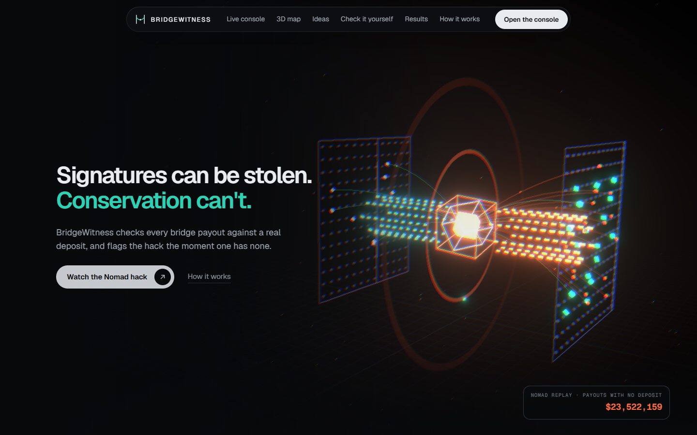
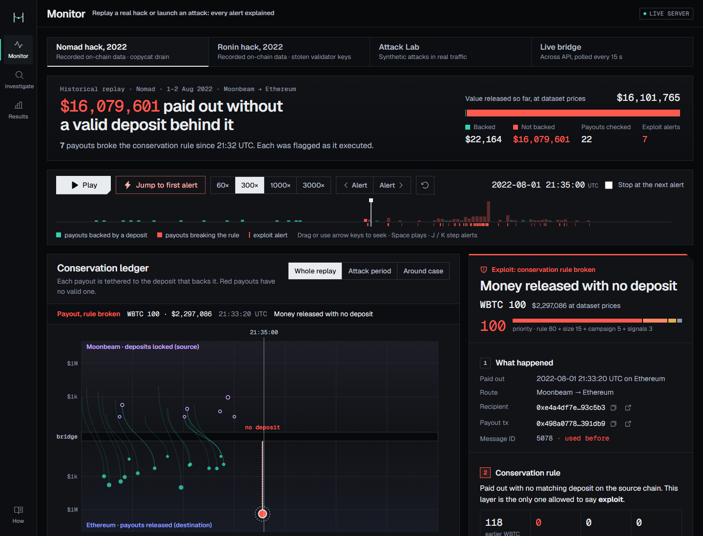
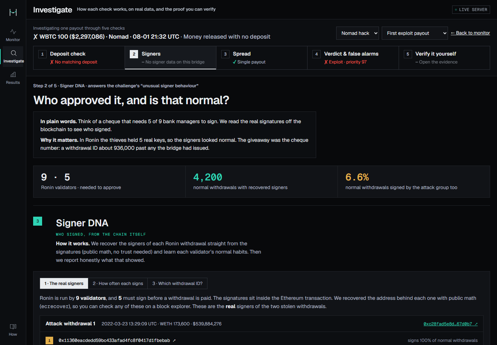
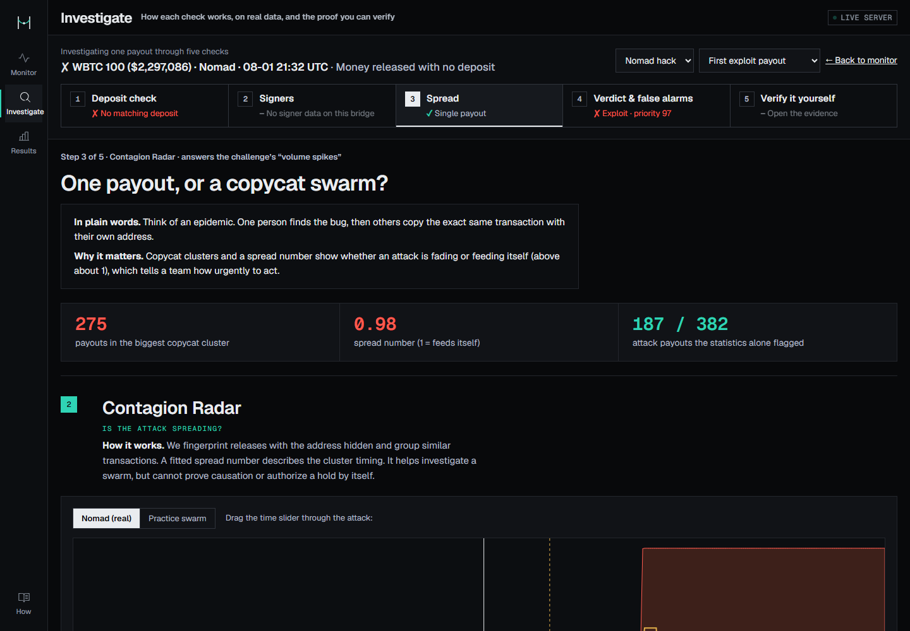
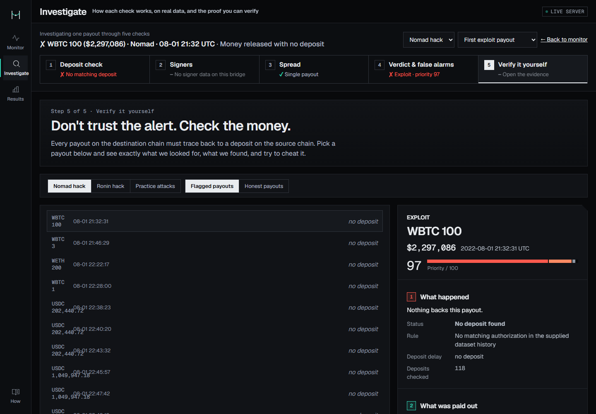
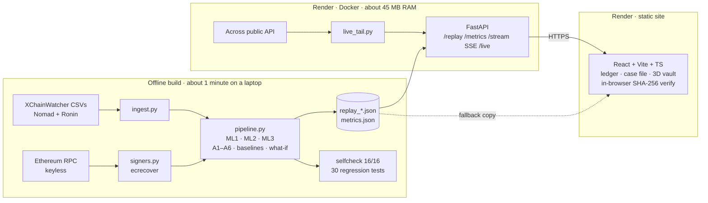

<div align="center">


# BridgeWitness

### Signatures can be stolen. Conservation can't.

**Real-time detection of cross-chain bridge exploits that accuses only with proof.**
It checks every bridge payout against a real deposit, measures how fast an attack spreads, recovers who really signed from the chain, and puts a measured false-alarm rate on every alert.

[**Live demo**](https://bridgewitness-web.onrender.com) · [**Watch it catch the Nomad hack**](https://bridgewitness-web.onrender.com/console/live?feed=nomad) · [API](https://bridgewitness-api.onrender.com/health) · [Technical details](docs/BridgeWitness-Tech-Details.md)




</div>

---

## Contents

- [The $2 billion problem](#the-2-billion-problem)
- [The one idea attackers can't fake](#the-one-idea-attackers-cant-fake)
- [Four ideas nobody else ships](#four-ideas-nobody-else-ships)
- [Where existing tools break, and what we do instead](#where-existing-tools-break-and-what-we-do-instead)
- [Results, measured](#results-measured)
- [See it](#see-it)
- [How it works](#how-it-works)
- [Architecture](#architecture)
- [Run it yourself](#run-it-yourself)
- [What we do not claim](#what-we-do-not-claim)
- [Research we build on](#research-we-build-on)

---

## The $2 billion problem

A cross-chain bridge locks your coins on chain A and pays out the same value on chain B. Its vault holds everyone's locked coins, which makes bridges the biggest single target in crypto: **about $2 billion was stolen from bridges in 2022**, roughly two thirds of all crypto stolen that year (Chainalysis).

| | **Ronin**, March 2022 | **Nomad**, August 2022 |
|---|---|---|
| How | Attackers stole **5 of 9** validator keys and signed two withdrawals **115 seconds apart** | A bug let anyone withdraw money that was never deposited; **hundreds of copycats** pasted the first attacker's transaction with their own address |
| Why monitors missed it | Every signature was **valid** | Copycats **reused real message IDs** (one ID 279 times) and many payouts were small |
| Loss | ~$624M public estimate ($565.4M in our dataset) | ~$190M public estimate (382 payouts in ~2.5 h in our dataset) |

Exploits finish in **minutes**. Today's monitors alert too late, alert so often that teams stop listening, or cannot say *why* something is an attack.

## The one idea attackers can't fake

> **Every coin paid out must have a coin locked in.**

Stolen keys can produce perfect signatures. A bug can skip a check. But neither can create a deposit that never happened on the other chain. BridgeWitness watches **both sides** of the bridge and checks every payout against the deposit history: same route, token and message, exact amount (to the last unit), same recipient, and **used only once**.

That conservation rule is the **only** thing allowed to say *exploit*. Everything else (statistics, ML, graph signals) can only say *suspicious*, and every alert carries the evidence so **anyone can re-check it in their browser**.

---

## Four ideas nobody else ships

### 1 · Accusation Budget: alerts with a measured false-alarm rate

Seven signals are each ranked against the latest **25,000 backed payouts** (rolling conformal p-values), turned into e-values, **averaged** (valid under any correlation between signals, Vovk & Wang 2021) and fed to an **e-CUSUM** detector (Shin, Ramdas & Rinaldo). The alarm line sits at 1,000, a design target of about one false alarm per 1,000 normal payouts, and we report the **measured** rate on held-out days: **0 / 1,826** on Nomad and **0 / 6,316** on Ronin.
Attackers can't poison "normal": only payouts the rule found **backed** ever enter the reference window.

### 2 · Contagion Radar: the R₀ of an exploit

Volume detectors look at size. Nomad was drained by **spread**. We fingerprint each payout with the recipient masked, cluster copy-paste payouts with **MinHash-LSH**, score repeat-message bursts with **MIDAS-R**, and fit a **Hawkes self-exciting process** to each cluster. Its branching ratio n̂ is the attack's reproduction number. On Nomad: a **275-payout** copycat cluster at **n̂ = 0.98**, a self-feeding swarm.

### 3 · Signer DNA: who actually signed, recovered from the chain

Other projects simulate "unusual signers". We **ABI-decode the raw calldata** of real Ronin withdrawals, rebuild the EIP-191 signed message and run **secp256k1 `ecrecover`** to recover the exact validators behind each one: 4,200 normal withdrawals plus both attacks. We recovered the **5 of 9** validators behind the hack, matching the public post-mortem.
And we report the uncomfortable truth: that 5-validator group also signed **6.6%** of normal withdrawals, so *who* signed looked normal. The real tell was the **withdrawal ID**: 2,000,000, about **936,000 past** anything the sidechain had issued. Signer DNA scores that jump.

### 4 · Ledger Pairing: every payout tied to its deposit

ID-matching is fooled by reused IDs; totals-only monitors know money is missing but not *which* transaction took it. We identify events by **(transaction, position)**, never by message ID alone, pair each payout with exactly one deposit, enforce **single use**, compare amounts as exact **uint256** integers, and learn each route's normal delay with **conformalized quantile regression** (98.3% measured coverage). The live **conservation ledger** shows each payout tethered to its deposit; red ones have none. Click one to open its case file.

---

## Where existing tools break, and what we do instead

| Limitation of existing approaches | What happened | What BridgeWitness does |
|---|---|---|
| **Signature checks trust valid signatures** | Ronin: stolen keys, valid signatures, nothing flagged | Checks **conservation**, which keys cannot fake; scores the **withdrawal-ID jump** from recovered on-chain data |
| **Message-ID joins** | Nomad copycats reused real IDs; an ID join catches **41 / 382** | Identity = tx + position; **amount, recipient and single-use** checks: **382 / 382** |
| **Fixed thresholds** ("> $1M", "3× volume") | Whale rule: 43 / 382 caught, 11 false alerts; z-score: 52 false alerts on Nomad | Statistics only *advise*; the rule *accuses*: **0 false exploit labels** |
| **No error control** | Nobody can say how many alerts are false → alert fatigue | e-value gate with **measured held-out false-alarm rates** |
| **Volume spikes miss swarms** | Nomad was many small payouts from new addresses | **Spread** measurement: copycat clusters + Hawkes n̂ |
| **Slow drains under every threshold** | Small payouts that never spike volume | Ledger sums everything: practice **slow drain caught 8 / 8** |
| **"Unusual signer" is simulated** | Demo data, not chain data | Real signers via `ecrecover`, with the honest result |
| **Black-box verdicts** | "Trust the score" | Rule reason + attack type + top-3 TreeSHAP reasons + closest past hack + **browser-verifiable evidence (SHA-256)** |
| **Missing data becomes a false accusation** | Late feeds create fake gaps | Missing or ambiguous history → `unknown`, never `violation` |
| **LLM guesses the attack type** | Unexplainable, inconsistent | Calibrated LightGBM typer, **constrained by the rule** (never "benign" after a violation; never "key compromise" without real signatures) |

| | Typical hackathon project | Research tools (XChainWatcher, BridgeShield) | Industry bots (Forta) | **BridgeWitness** |
|---|---|---|---|---|
| Real time | Simulated | Offline | One chain per bot | **Both chains, event-time replay + live tail** |
| Mismatched pairs | ID join | Rules / graph model | No | **Keyed pairing + single use + learned windows + drill-down** |
| Signer behaviour | Simulated | No | No | **Recovered from chain** |
| Volume spikes | z-score | No | z-score | **Exploit R₀ (Hawkes)** |
| False-alarm control | None | None | None | **e-values + measured rate** |
| Evidence | None | Paper | None | **Re-verify in the browser** |

---

## Results, measured

Every number below is produced by `python -m bridgewitness.pipeline` and asserted by `python -m bridgewitness.selfcheck` (16/16 passing).

| | Nomad 2022 (real) | Ronin 2022 (real) | Practice attacks (simulated) |
|---|---|---|---|
| Attack payouts labelled **exploit** | **382 / 382** | **2 / 2** | **38 / 38** |
| Honest payouts ever labelled exploit | **0** | **0** | **0** (controls clean) |
| Statistical false alarms, held-out normal days | **0 / 1,826** (31.9 days) | **0 / 6,316** (28.6 days) | 2 / 2,126 |
| Statistics alone (rule switched off) | 187 / 382, from the **first** attack payout | 1 / 2 | 16 / 38 |
| Suspected type on attack payouts | copycat swarm 317 · recipient mismatch 28 · replay 22 · unbacked 10 · amount 5 | key compromise 2 | all 7 attack scenarios typed |

**Same data through the usual methods (Nomad):**

| Method | Attack payouts caught | False alerts |
|---|---|---|
| Whale threshold > $1M | 43 / 382 | 11 |
| Volume z-score > 3 | 321 / 382 | 52 |
| Message-ID join | 41 / 382 | 0 |
| **BridgeWitness** | **382 / 382** | **0** |

**If the route had been held at the first exploit alert** (dataset USD, attackers otherwise unchanged):

| Hold | Nomad | Ronin |
|---|---|---|
| Before the first flagged payout executes | **$159.6M kept (100%)** | **$565.4M kept (100%)** |
| 1 minute after | $143.5M kept (89.9%) | $25.5M (4.5%) |
| 15 minutes after | $143.0M kept (89.6%) | $0 |

Ronin's two withdrawals were 115 s apart, so only a pre-execution gate saves it. Nomad's swarm ran for hours, so even a 15-minute hold keeps about 90%.

**Practice feed (Attack Lab):** fake deposit, message replay, key compromise with the real stolen signer set, 25-payout copycat swarm, amount mismatch (+1 unit), recipient swap and an 8-payout **slow drain**, all caught. A $3M whale and a 12-payout honest burst raise nothing.

---

## See it

| Monitor: replay a real hack, every payout checked | Investigate: one case through five checks |
|---|---|
|  |  |
| **Contagion Radar: copycat cluster and spread** | **Verify it yourself: don't trust the alert, check the money** |
|  |  |

**60-second tour:** open the [live demo](https://bridgewitness-web.onrender.com) → *Watch the Nomad hack* → *Jump to first alert* → read the case file → *Verify it yourself* and try to cheat the check by changing one unit.

| Page | What you do there |
|---|---|
| [`/console/live`](https://bridgewitness-web.onrender.com/console/live) **Monitor** | Replay Nomad or Ronin at 60–3000×, launch attacks in the Attack Lab, or watch the **live Across bridge**. Conservation ledger, alert list, case file, what-if, baseline scorecard. Space = play, J/K = step alerts |
| [`/console/pairing`](https://bridgewitness-web.onrender.com/console/pairing) **Investigate** | One payout through 5 questions: deposit check → signers → spread → verdict & false alarms → verify |
| [`/console/evidence`](https://bridgewitness-web.onrender.com/console/evidence) **Verify** | What was searched, what was found, explorer links, and a "try to cheat it" box |
| [`/console/results`](https://bridgewitness-web.onrender.com/console/results) **Results** | Every measured number and what we do not claim |

---

## How it works

```
payout arrives
  1  RULE        deposit with same (route, token, message)?  exact amount?  same recipient?  not used before?
                 → consistent · violation (with reason) · unknown            ← the only path to "exploit"
  2  SIGNALS     volume spike · repeat-message burst (MIDAS-R) · copycat cluster (MinHash-LSH)
                 · spread n̂ (Hawkes) · value vs route · withdrawal-ID jump · signer/ID model (ML2)
  3  GATE        rolling conformal p-values → e-values → average → e-CUSUM   ← "suspicious" only
  4  RISK 0–100  rule severity + exposure + campaign + surprise; capped at 69 without a broken rule
  5  TYPE        ML3 names the attack + top-3 TreeSHAP reasons + closest past hack (rule-constrained)
  6  EVIDENCE    bundle + SHA-256 → the browser recomputes the hash and re-runs the rule
```

**Three ML models**

| | Model | Learns from | Measured |
|---|---|---|---|
| ML1 | LightGBM quantile regression + **conformalized quantile regression** | 19,170 real deposit→payout pairs, time-ordered split | 98.3% coverage on unseen pairs (target 99%) |
| ML2 | **Isolation Forest** + Dirichlet–multinomial signer-group likelihood | 4,200 real Ronin withdrawals with recovered signers | attacks p = 0.062 vs normal median 0.505 |
| ML3 | LightGBM multiclass + **isotonic calibration** + exact **TreeSHAP** (`pred_contrib`) | synthetic attack scenarios over real normal traffic | typing only; never makes the accusation |

**Six algorithms:** conservation ledger · exact single-use pairing · MinHash-LSH · MIDAS-R · Hawkes MLE · rolling conformal → e-values → e-CUSUM.

Full detail, with every parameter, number and file: **[docs/BridgeWitness-Tech-Details.md](docs/BridgeWitness-Tech-Details.md)**.

---

## Architecture



Heavy work (training, sketches, Hawkes fits) runs **offline**; the server only streams precomputed replays and polls one public API. That is how a full ML pipeline runs on Render's **free 512 MB** tier at about **45 MB RAM**, with **zero paid services and zero required API keys**. If the API is asleep, the site falls back to the same replay files bundled with it, so the demo never breaks.

**Stack:** Python 3.10 · FastAPI · pandas · NumPy · SciPy · LightGBM · scikit-learn · datasketch · eth-keys · React 18 · TypeScript · Vite · Three.js (React Three Fiber) · uPlot · Docker · Render · GitHub Actions.

---

## Run it yourself

```bash
# backend: rebuild every artifact and verify (about 1 minute)
pip install -r bridgewitness/requirements-build.txt
python -m bridgewitness.pipeline
python -m bridgewitness.selfcheck          # 16/16
python -m unittest bridgewitness.test_regressions
uvicorn bridgewitness.api:app --port 8077

# frontend
cd web && npm install && npm run data && npm run dev
```

Set `VITE_BW_API=http://localhost:8077` in `web/.env.local` to use the local API; without it the site uses its bundled replay files. Deployment is one Render Blueprint ([`render.yaml`](render.yaml)).

<details>
<summary><b>Repository layout</b></summary>

```
bridgewitness/          Python backend
  ingest.py             CSVs → one event table (identity = tx hash + position)
  signers.py            calldata decode + ecrecover of Ronin validators
  algos.py              the six algorithms (+ self-test)
  ml.py                 the three models
  pipeline.py           offline build, practice attacks, baselines, what-if
  selfcheck.py          16 golden checks · test_regressions.py: 30 behaviour tests
  api.py · live_tail.py FastAPI server and the live Across tail
  artifacts/            replays + metrics (committed)
  data/raw/             pinned XChainWatcher dataset (MIT)
web/                    React + Vite + TypeScript site
docs/                   technical details, spec PDF, prototype guide, screenshots
pitch/                  pitch deck and presenter notes
NEW.md · HANDOFF.md     product spec and build handoff
```
</details>

---

## What we do not claim

- Two real hacks plus practice attacks show the idea works; they are not a promise for every future attack. Results are reported **per incident**, never as one global accuracy.
- Dataset labels come from XChainWatcher's rules, which check a similar invariant, so the rule-layer catch rate is partly circular. The statistics-only results (rule switched off) are the independent check.
- The practice feed is simulated. ML3's typing accuracy is measured on synthetic data only.
- The "one false alarm per 1,000" line is a design target; we show the measured rate beside it.
- The Ronin signers were ordinary; the withdrawal ID was not. We never claim otherwise.
- The live Across tail shows API-reported transfer status; it does not verify backing on chain, and the models abstain there.
- Dollar figures are dataset values. "Kept in the bridge" is computed from the data, not money actually saved.

## Research we build on

Liu et al., *Count of Monte Crypto* (accounting invariant) · Augusto et al., *XChainWatcher* (rules + dataset) · Lee et al. and Notland et al., bridge-attack SoKs · Romano, Patterson & Candès, *Conformalized Quantile Regression* · Bates et al., *conformal p-values* · Vovk & Wang, *E-values* · Shin, Ramdas & Rinaldo, *E-detectors* · Bhatia et al., *MIDAS* · Hawkes (1971) · Broder (1997), MinHash · Qin et al., *The Blockchain Imitation Game* · Lundberg et al., TreeSHAP.

Data: [XChainWatcher](https://arxiv.org/abs/2410.02029) dataset (MIT, see [`web/public/THIRD_PARTY_NOTICES.txt`](web/public/THIRD_PARTY_NOTICES.txt)) · public Ethereum RPC · [Across](https://across.to) public API.

<div align="center">
<br/>
<b>BridgeWitness</b> · built for CSB-01 · Real-Time Detection of Cross-Chain Bridge Exploits
</div>
